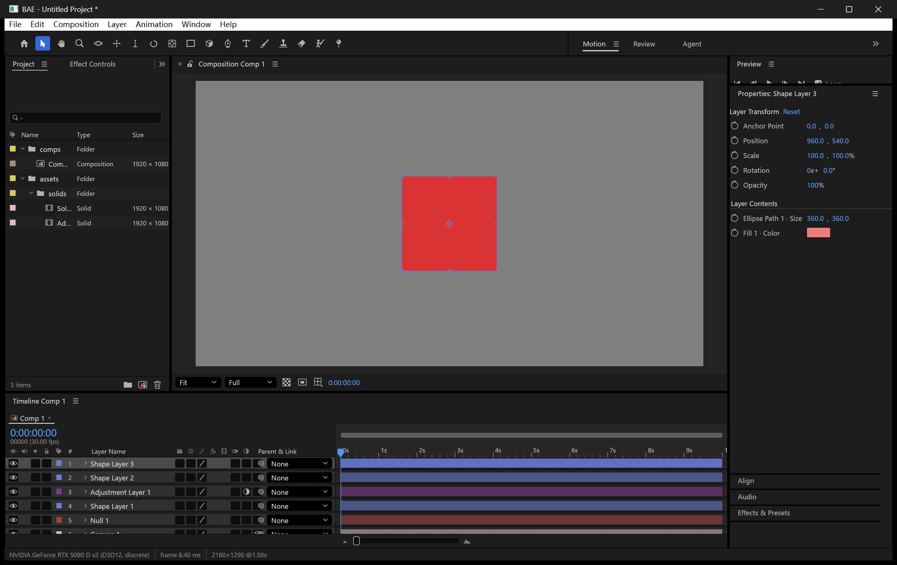
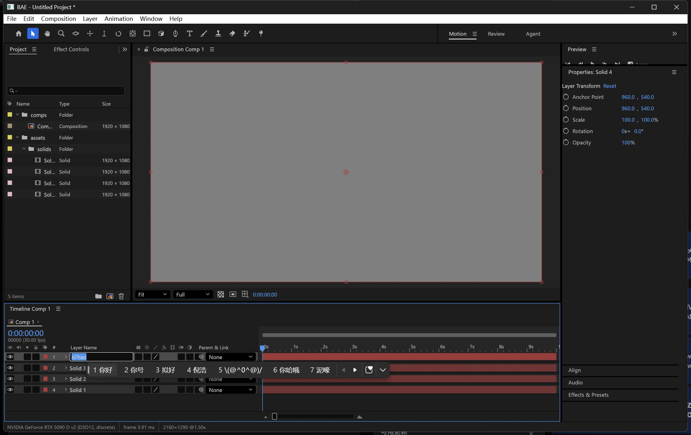
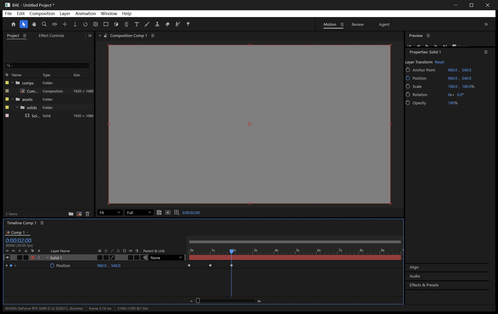
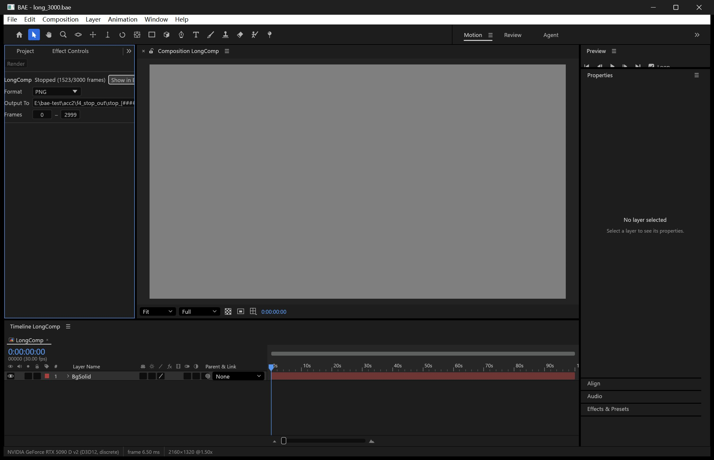
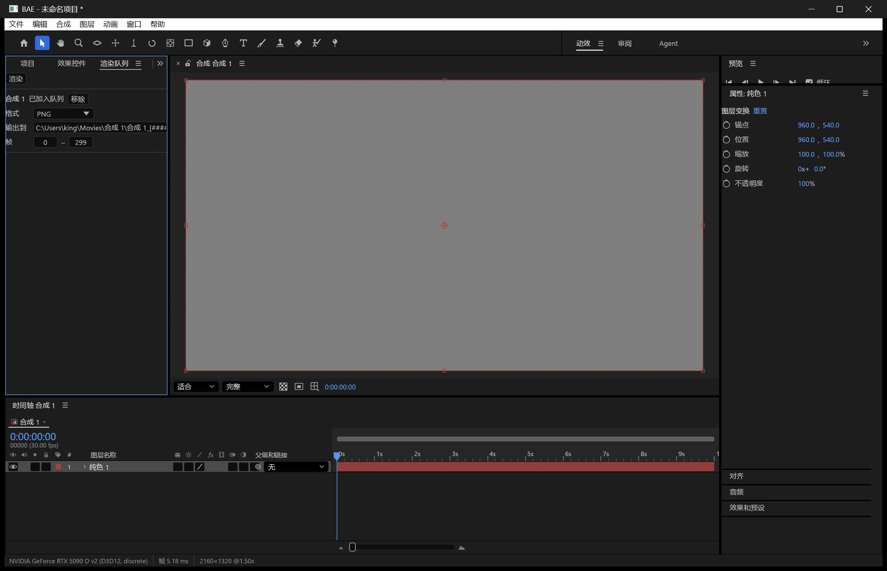
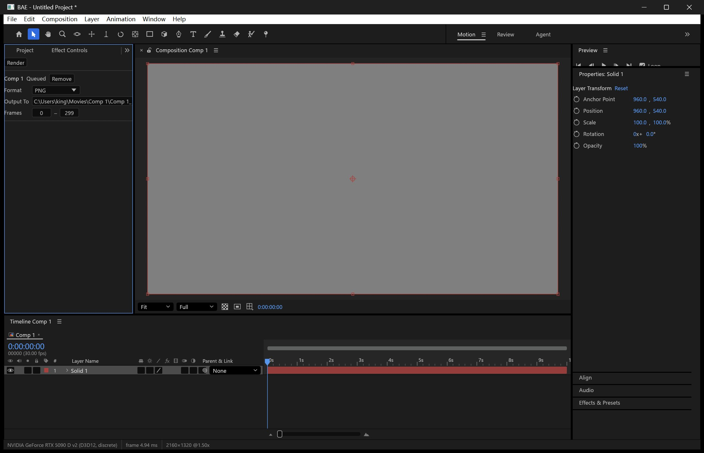
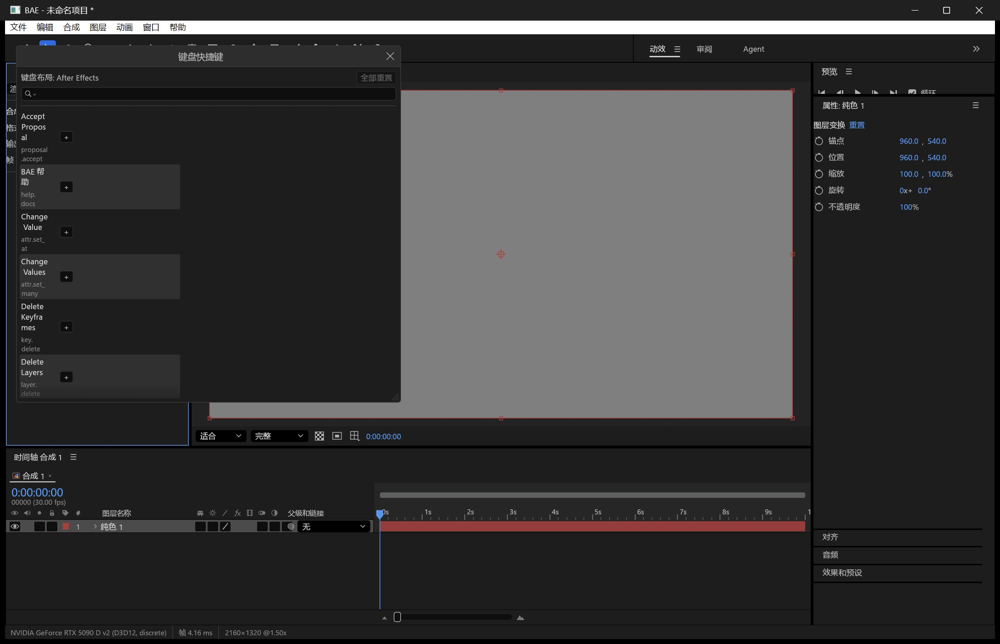

# Windows 实机：BAE 0.0.1 独立验收第二轮

## 环境信息

- **日期**：2026-11-21
- **分支 / 基线**：
  - **A–E** 测于 `origin/dev` @ **`fb08040ff6b0019763d1f941f87427af355d4af8`**（`fb08040`）
  - **已有 Issue 复测与 F–H** 测于 `origin/dev` @ **`c20770a75f375be4ea2674f64873a813ec90396b`**（`c20770a`，含 #121 / #123 / #127；其中部分复测先在 `763eaad` / `d23a328` 验证并在 `c20770a` 复核）
- **操作系统**：Microsoft Windows 11 专业版 10.0.26200（Build 26200，中文 zh-CN，`OSLanguage=2052`）
- **GPU**：NVIDIA GeForce RTX 5090 D v2（驱动 `32.0.16.1692`，D3D12）
- **显示 / DPI**：3840×2160，系统缩放 **150%**（`AppliedDPI=144`，窗口渲染 `@1.50x`）
- **构建**：`cargo build --release -p bae`（默认设置，未设 `WGPU_DX12_COMPILER`），`target/release/bae.exe` = **30,635,008 bytes（29.22 MB，`fb08040`）** / **31,131,648 bytes（29.69 MB，`c20770a`）**
- **输入法**：微软拼音（`0x8040804`）
- **操作与锁**：全程持有 `E:\bae-test\locks\gui.lock`（每 20 分钟刷新，测毕释放）；GUI 操作经由 `orca computer`（`launch-app` / `get-app-state` / `press-key` / `hotkey` / `click` / `type-text`，`--restore-window`、`--screenshot-scale 1`）；切至 `d23a328` / `c20770a` 后按钮与控件交互全部改用 Windows UIA `--element-index`。

---

## 总表（A–H）

| 项 | 验收范围 | 实测基线 | 结论 | 关联 Issue | 摘要 |
|---|---|---|---|---|---|
| **A** | 启动和欢迎框 | `fb08040` | **通过** | — | 冷启动 0.94 s 弹出欢迎框；Esc、关闭按钮（×）、点框外均可关闭；Motion / Review / Agent 三个入口按钮均正确切换工作区；正常关闭后热启动 0.82 s 不再弹出欢迎框 |
| **B** | 新建合成、图层 ▸ 新建、菜单与快捷键 | `fb08040`（`763eaad` / `c20770a` 已复测修复） | **初测失败 → 复测通过** | [#117](https://github.com/FELIXDAD/betterAfterEffects/issues/117)（已关）, [#118](https://github.com/FELIXDAD/betterAfterEffects/issues/118)（已关） | 新建合成与 `Layer ▸ New` 全部 9 项图层创建及 `export-json` 均通过；菜单置灰逻辑正确；#117（菜单快捷键显示）与 #118（Window ▸ Render Queue 及 `Ctrl+Alt+0`）在 `c20770a` 复测均通过；`Ctrl+Shift+S` 在本机被系统全局热键占用（1409），属**环境/自动化受限** |
| **C** | 时间轴改名（IME / 空格 / Emoji / 超长名） | `fb08040` | **通过** | [#106](https://github.com/FELIXDAD/betterAfterEffects/issues/106)（已关）, [#113](https://github.com/FELIXDAD/betterAfterEffects/issues/113)（已关） | 真实微软拼音 IME 组字选词（`ni'hao` → `你好`）、含空格名（不触发播放）、Emoji（`🎬 场记测试`）、323 字符超长名全部正常显示且经保存—重开与 `export-json` 逐字一致；初测复现的 #106、#113 在 `c20770a` 复测均已通过 |
| **D** | 关键帧、播放、焦点与撤销重做 | `fb08040` | **通过** | — | 秒表与导航器 ◆ 打 3 个关键帧（0s/1s/2s）均确认 ◆ 变蓝并落盘；J/K 精准跳转；空格播放/停止在 4 个面板生效，在搜索框与改名框不触发播放；连续 4 步图层与 3 步关键帧撤销/重做经 `export-json` 核验一致；选中关键帧后 `Animation` 菜单 5 项全启用 |
| **E** | 保存和打开（边界与异常） | `fb08040`（#111 在 `c20770a` 复核） | **失败** | [#126](https://github.com/FELIXDAD/betterAfterEffects/issues/126)（OPEN）, [#111](https://github.com/FELIXDAD/betterAfterEffects/issues/111)（OPEN） | `.bae`/`.baez` 保存重开、`Ctrl+S`、脏关闭三键、空格/中文路径、只读目录报错不崩、命令行打开、`.baez` 覆盖确认均通过；Windows 另存为覆盖已存在 `.bae` 文件夹会直接进入该目录（#126）；#111 GUI 报错在 `c20770a` 已改善但 CLI 仍多输出一行 timestamped `ERROR` 日志 |
| **F** | 渲染队列（格式 / 停止 / 错误 / 满盘 / 多合成） | `c20770a` | **通过**（满盘**自动化受限**） | [#110](https://github.com/FELIXDAD/betterAfterEffects/issues/110)（已关）, [#133](https://github.com/FELIXDAD/betterAfterEffects/issues/133)（OPEN，布局裁切见 H） | PNG / 未压缩 TIFF（Tag 259=1）/ OpenEXR 均输出合法像素；在资源管理器中显示打开准确目录；非法路径报明确 OS 错误不崩；3000 帧渲染中途点击 Stop 精确停在 `1523/3000` 且磁盘恰 1523 帧；渲染中删层不崩且首末帧均为隔离快照像素；多合成依次排队渲染完成；**满盘项因非管理员会话无法挂载小容量 VHD 归类为自动化受限** |
| **G** | 语言（`BAE_LANG=zh` / `en`） | `c20770a` | **失败** | [#136](https://github.com/FELIXDAD/betterAfterEffects/issues/136)（OPEN）, [#135](https://github.com/FELIXDAD/betterAfterEffects/issues/135)（OPEN） | `BAE_LANG=en` 无中文泄漏；`BAE_LANG=zh` 主菜单、工作区、欢迎框、渲染队列状态/报错、脏关闭弹窗与关于框均已中文化，但存在 **14 个未翻译英文命令名**（导致 `编辑 ▸ 撤消 New Layer`、历史记录与快捷键对话框中英混排）及 **3 个原始面板 ID**（`character`/`paragraph`/`tools`）（#136）；空渲染队列提示 `▸` 缺字成 `□`（#135） |
| **H** | 150% DPI 清晰度与布局 | `c20770a` | **失败** | [#133](https://github.com/FELIXDAD/betterAfterEffects/issues/133)（OPEN）, [#134](https://github.com/FELIXDAD/betterAfterEffects/issues/134)（OPEN）, [#135](https://github.com/FELIXDAD/betterAfterEffects/issues/135)（OPEN） | 字体、图标、时间轴刻度与画布在 `@1.50x` 下清晰锐利；但存在三处明显布局/渲染问题：1) `Motion` 默认布局中 **Preview 播放控制栏被纵向腰斩**、**Render Queue 右侧按钮被裁出窄左栏**（#133）；2) **键盘快捷键对话框命令列被挤压至 ~45 px 强制断词，右半边大片空白**（#134）；3) 渲染队列空提示 `▸` 显示为缺字方块 `□`（#135） |

> 结论汇总：本轮未发现 **`0.0.1-blocker`**（无崩溃、无卡死、无数据丢失、无核心主流程不可用）；共新提 **5 个 `bug`**（#117、#118 已修并关闭；**#126、#133、#134、#135、#136** 仍 OPEN），跨平台复测并验证 **12 个已有 issue 全部通过**（#106–#110、#112–#114、#116–#118、#124，其中在 Windows 上直接关闭 #124 并在其余已关 issue 下补发 Windows 复测记录），在 **#111** 与 **#128**（OPEN）补充了 Windows 实机现象。

---

## A. 启动和欢迎框

**结论：通过**

测试前清空 `%LOCALAPPDATA%\BAE\State\` 下的 `workspaces.json` 与 `window.json` 以复现真实冷启动。

| 检查项 | 操作与验证方式 | 结果 | 实测现象与证据 |
|---|---|---|---|
| 冷启动 | 删除 `workspaces.json` / `window.json` 后 `orca computer launch-app bae.exe --activate` | **通过** | 0.94 s 出现主窗口 `BAE - Untitled Project`，弹出居中模态框 **Welcome to BAE**，状态栏显示 `NVIDIA GeForce RTX 5090 D v2 (D3D12, discrete) \| frame 7.68 ms \| 2160×1320 @1.50x`（见图 1） |
| 欢迎框 — Esc 关闭 | 欢迎框打开时按 `Escape` | **通过** | 模态框立即消失，停留在默认 `Motion` 工作区，界面可交互 |
| 热启动不再弹出 | 通过窗口关闭按钮正常退出，确认 `%LOCALAPPDATA%\BAE\State\workspaces.json` 已生成，再次启动 | **通过** | 0.82 s 打开主窗口，不再弹出欢迎框 |
| 欢迎框 — 关闭按钮（×） | 冷启动后 `Tab` ×1 聚焦右上角 `×` 按钮，按 `Enter` | **通过** | 模态框关闭，保留 `Motion` 工作区 |
| 欢迎框 — 点框外 | 冷启动后点击模态框外区域（窗口坐标 `150, 260`） | **通过** | 模态框关闭，背景区域（项目面板）正常响应焦点 |
| 三个入口按钮 — Motion | 冷启动后 `Tab` ×2 + `Enter` 选择 `Motion` | **通过** | 模态框关闭，`Motion` 工作区高亮（含 Project / Effect Controls、Composition、Timeline、Preview、Properties / Align / Audio / Effects & Presets） |
| 三个入口按钮 — Review | 冷启动后 `Tab` ×3 + `Enter` 选择 `Review` | **通过** | 模态框关闭，切换至 `Review` 工作区（大画幅 Composition、Timeline、Preview、History / Info） |
| 三个入口按钮 — Agent | 冷启动后 `Tab` ×4 + `Enter` 选择 `Agent` | **通过** | 模态框关闭，切换至 `Agent` 工作区（Composition、Timeline、Agent Activity、Proposals / History） |
| 未开放项置灰 | 观察 `Storyboard · coming later` 与 `Editing · coming later` | **通过** | 呈置灰不可点击状态，`Tab` 焦点自动跳过 |

---

## B. 新建合成、图层 ▸ 新建、菜单状态与快捷键

**结论：失败（bug：[#117](https://github.com/FELIXDAD/betterAfterEffects/issues/117)、[#118](https://github.com/FELIXDAD/betterAfterEffects/issues/118)）**

通过用户桌面 Win32 `GetMenuItemInfoW` 枚举全部菜单文本、快捷键字符串与启用状态，并在界面中逐一执行新建合成、新建 9 种图层及主要快捷键，最后保存至 `E:\bae-test\acc2\b_9layers.bae` 并用 `bae.exe export-json` 核验数据结构。

| 检查项 | 结果 | 实测现象与证据 |
|---|---|---|
| 新建合成（`Ctrl+N`） | **通过** | 创建 `Comp 1`（1920×1080，30.00 fps），标题变为 `BAE - Untitled Project *`，时间轴与查看器同步打开 |
| `Layer ▸ New` 全部 9 项 | **通过** | 经菜单逐一创建 `Text`、`Solid`、`Light`、`Camera`、`Null Object`、`Shape Layer`、`Adjustment Layer`、`Rectangle`、`Ellipse`，均无报错（见图 2）；单独验证 `Ellipse` 正确渲染为红色圆形（360×360）；`bae.exe export-json` 确认 9 层 `kind`（`text`/`solid`/`light`/`camera`/`null`/`shape`×3/`adjustment`）与 `solids` 资产完整落盘 |
| 无合成时 `Layer ▸ New` 置灰 | **通过** | `GetMenuItemInfoW` 实测无合成时 `Layer ▸ New` 下全部 9 项均为 `OFF`（`MFS_DISABLED`）；新建合成后全部变为 `ON` |
| 合成 / 动画 / 编辑 / 排列菜单可用状态 | **通过** | 无合成：`Trim Comp to Work Area`、`Add to Render Queue`、`Undo`/`Redo`、`Duplicate`/`Split Layer`、`Arrange` 4 项、`Animation` 5 项全 `OFF`；有合成无选中图层：`Composition` 3 项与 `Undo New Composition` 变为 `ON`，`Arrange`/`Duplicate`/`Split Layer`/`Animation` 仍 `OFF`；选中图层后：`Arrange` 4 项与 `Duplicate`/`Split Layer` 变为 `ON`，`Animation` 5 项因无选中关键帧仍 `OFF`（选中关键帧后的启用态将在 D 项一并复核） |
| 主要快捷键功能验证 | **通过**（`Ctrl+Shift+S` 自动化受限） | `Ctrl+N`（新建合成）、`Ctrl+Y`（新建纯色）、`Ctrl+D`（复制图层）、`Ctrl+Z`（撤销）、`Ctrl+Shift+Z`（重做）、`Ctrl+M`（加入渲染队列）、`Ctrl+S`（弹出 `Save As` 对话框并落盘）、`Ctrl+O`（弹出 `Open Project` 对话框，取消后 `IsWindowEnabled=True`）均生效；**`Ctrl+Shift+S` 自动化/环境受限**：经用户桌面 `RegisterHotKey(MOD_CONTROL\|MOD_SHIFT, 'S')` 确认返回 `ERROR_HOTKEY_ALREADY_REGISTERED (1409)`，被本机系统级热键拦截（`Ctrl+Shift+Z`/`Ctrl+Shift+D`/`Ctrl+S` 均空闲），非 BAE 缺陷 |
| 菜单显示快捷键与键位表一致性 | **失败（#117）** | 模块贡献项与 File 菜单项（`Ctrl+Alt+N` / `Ctrl+O` / `Ctrl+S` / `Ctrl+Shift+S` / `Ctrl+N` / `Ctrl+M` / `Ctrl+Y` / `Ctrl+D` / `Ctrl+Shift+D` / `F9` 等）显示一致；但 **`Edit ▸ Undo` 与 `Edit ▸ Redo` 未显示 `Ctrl+Z` / `Ctrl+Shift+Z`**（同属 Shell 硬编码的 `Keyboard Shortcuts`、`Exit` 及 `Window` 面板项也均缺失快捷键显示），已两次复现并提 [#117](https://github.com/FELIXDAD/betterAfterEffects/issues/117) |
| Window 菜单面板完整性 | **失败（#118）** | `Window` 菜单缺少 **`Render Queue`（渲染队列）** 入口（与 `render_queue.rs` 注释及 `Ctrl+Alt+0` 不一致），已提 [#118](https://github.com/FELIXDAD/betterAfterEffects/issues/118) |

---

## C. 时间轴改名

**结论：通过**

在 `Comp 1` 中创建 4 个纯色图层（`Solid 1`–`Solid 4`），通过双击时间轴 `Layer Name` 列触发行内改名（注：选中图层按 `Enter` 不触发改名，仅双击触发，`crates/bae-ui-motion/src/timeline.rs:1067`），逐一完成 4 类输入后保存为 `E:\bae-test\acc2\c_rename.bae`，关闭进程并以命令行重新打开该工程、双击项目面板中的 `Comp 1` 核验界面显示，同时以 `bae.exe export-json` 逐字比对落盘值。

| 检查项 | 操作与验证方式 | 结果 | 实测现象与证据 |
|---|---|---|---|
| 真实中文输入法组字 | 双击第 1 行图层名，确认微软拼音处于中文输入态（`IMC_GETOPENSTATUS=1`，`IMC_SETCONVERSIONMODE=1`），发送真实物理按键 `n i h a o`，截图确认预编辑 `ni'hao` 与微软拼音候选框 `1 你好 2 你号 ...` 正确跟随光标弹出（见图 3），按 `1` 选词再按 `Enter` 提交 | **通过** | 预编辑、候选框定位、选词上屏与回车提交均顺畅，图层名成功改为 `你好` |
| 含空格图层名 | 双击第 2 行图层名，使用物理 `Space` 键与文本输入 `My Layer With Spaces 01` 后按 `Enter` | **通过** | 空格正常输入为字符，时间码保持 `0:00:00:00` 未误触发播放 |
| Emoji 图层名 | 双击第 3 行图层名，输入 `🎬 场记测试` 后按 `Enter` | **通过** | 场记板 Emoji 正常渲染（无乱码/方框），中文同显正常 |
| 超长图层名（>300 字符） | 双击第 4 行图层名，输入 323 字符名称（`LongName_` + 31×`A123456789` + `_END`）后按 `Enter` | **通过** | 无崩溃、无卡顿，时间轴 `Layer Name` 列按列宽自动截断为 `LongName_A123456789...`，不挤占右侧开关与 Parent 列 |
| 保存—关闭—重开持久化 | `Ctrl+S` 保存至 `c_rename.bae`，关闭并重开工程，核对界面（见图 4）与 `bae.exe export-json` | **通过** | 4 个图层名在界面与 `export-json` 中均 100% 逐字一致：`/comps/Comp_1/layers/Solid_4`=`"你好"`（len=2）、`Solid_3`=`"My Layer With Spaces 01"`（len=23）、`Solid_2`=`"🎬 场记测试"`（len=6）、`Solid_1` 完整保留 323 字符 |

> 附注（已有 issue 跨平台复现）：测试中同时复现了 [#106](https://github.com/FELIXDAD/betterAfterEffects/issues/106)（时间轴选中图层按 `Enter` 不能开始改名；双击进入改名框后未全选原名）和 [#113](https://github.com/FELIXDAD/betterAfterEffects/issues/113)（重开工程后未自动打开合成），均已在原 issue 下补充 Windows 实机复现评论，未重复开 issue。

---

## D. 关键帧、播放、焦点与撤销重做

**结论：通过**

在 `Comp 1` 中创建 `Solid 1` 并按 `P` 展开 `Position`，全程点击秒表与关键帧导航器 `◆` 打帧（避开中文输入法可能吞掉的 `Alt+Shift+*`），逐帧以像素检测确认导航器 `◆` 蓝像素数（无帧 0 px → 有帧 85 px），并结合时间码截图与 `bae.exe export-json` 核验。

| 检查项 | 操作与验证方式 | 结果 | 实测现象与证据 |
|---|---|---|---|
| 秒表打关键帧（0s） | 点击 `Position` 秒表 `(228, 1162)` | **通过** | 秒表与左侧导航器 `◆` `(48, 1163)` 均变蓝（蓝像素 85 px），时间轴轨道 `0s` 出现菱形关键帧 |
| 导航器 ◆ 打关键帧（1s / 2s） | `Shift+PageDown` ×3 跳至 `0:00:01:00`（`◆` 变灰，蓝像素 0）→ 点 `◆`（变蓝 85 px）；再跳至 `0:00:02:00`（`◆` 变灰，0）→ 点 `◆`（变蓝 85 px）（见图 5） | **通过** | 3 个关键帧（`0` / `705600000` / `1411200000` ticks）均精确写入 `transform:position.keyframes` |
| 选中关键帧后 `Animation` 菜单状态（补测 B） | 单击轨道 `2s` 关键帧菱形选中后 `GetMenuItemInfoW` 枚举 | **通过** | `Animation ▸ Keyframe Assistant` 4 项（`Easy Ease`、`Easy Ease In`、`Easy Ease Out`、`Time-Reverse Keyframes`）与 `Toggle Hold Keyframe` 全部由灰变为启用 |
| `J` / `K` 在关键帧之间跳转 | 从 `0:00:02:00` 依次按 `J`、`J`、`K`、`K` | **通过** | 时间码精准依次跳转：`0:00:01:00` → `0:00:00:00` → `0:00:01:00` → `0:00:02:00`，每次跳转后 `◆` 均为蓝色（85 px） |
| 空格播放 / 停止 — 4 面板焦点 | 依次点击聚焦 **时间轴**、**合成查看器**、**项目面板**、**历史面板**（通过 `Window ▸ History` 打开），`Home` 归零后 `Space` 播放 ~0.6 s 再 `Space` 停止，停后等待 0.4 s 复核时间码静止 | **通过** | 4 个面板焦点下均正常起播并立即停止：Timeline `0:00:00:00 → 0:00:01:07` 静止；Composition / Project / History 均 `0:00:00:00 → 0:00:01:05` 静止（停后 0.4 s 像素差为 0） |
| 空格 — 文本框焦点不播放 | 1) 点击项目面板搜索框，输入 `foo` + 物理 `Space` + 等 0.55 s + `bar`；2) 时间轴改名框（C 项）输入含空格名 | **通过** | 搜索框清晰显示 `foo bar`，时间码始终保持 `0:00:00:00`（像素差 0），不触发播放 |
| 连续撤销与重做（图层 + 关键帧） | 1) 连续 4 次图层操作（`Ctrl+Y` / `Ctrl+Y` / `Ctrl+D` / `Ctrl+Y`，4→8 层）→ `Ctrl+Z` ×4 → `Ctrl+Shift+Z` ×4；2) 3 个关键帧 → `Ctrl+Z` ×3 → `Ctrl+Shift+Z` ×3；每步保存后用 `export-json` 核对 | **通过** | 图层：`8 层 → 4 层 → 8 层` 完全一致；关键帧：`3 帧（0/1s/2s）→ 0 帧（纯静态值）→ 3 帧（0/1s/2s）` 完全一致 |

---

## E. 保存和打开

**结论：失败（新提 bug：[#126](https://github.com/FELIXDAD/betterAfterEffects/issues/126)；复现并评论已有 bug：[#111](https://github.com/FELIXDAD/betterAfterEffects/issues/111)）**

本节全部用例均测于 `origin/dev` @ `fb08040`，结果均经 Win32 对话框检查、`IsWindowEnabled` 与 `bae.exe export-json` 核对。

| 检查项 | 操作与验证方式 | 结果 | 实测现象与证据 |
|---|---|---|---|
| `.bae` 与 `.baez` 保存/重开 | 新建工程保存为 `e_test.bae`，`File ▸ Save As...` 保存为 `e_test.baez`（确认合法 zip），再命令行打开 `.baez` 增层并 `Ctrl+S` | **通过** | `.bae` 与 `.baez` 均可读写；`.baez` 增层保存后 `export-json` 确认 `['Solid 3', 'Solid 2', 'Solid 1']` |
| `Ctrl+S` 增量保存 | 打开 `e_test.bae`（1 层）后增层（标题变 `BAE - e_test.bae *`），按 `Ctrl+S` | **通过** | 无弹窗直接原地保存，标题 `*` 清除，`export-json` 更新为 `['Solid 2', 'Solid 1']` |
| 脏关闭提示 — 取消（`Esc`） | 修改 `e_test.bae`（新增 `Comp 2`，标题带 `*`）→ `File ▸ Exit` 弹出 `Save changes to “e_test.bae” before closing?`（`是(Y)` / `否(N)` / `取消`）→ 按 `Esc` | **通过** | 弹窗关闭，主窗口保留运行（`IsWindowEnabled=True`，标题仍 `BAE - e_test.bae *`），磁盘仍为 `['Comp_1']` |
| 脏关闭提示 — 不保存（`N`） | 再次 `File ▸ Exit` → 按 `N` | **通过** | 进程正常退出，磁盘 `export-json` 仍为 `['Comp_1']`（未保存 `Comp_2`） |
| 脏关闭提示 — 保存（`Y`） | 重开 `e_test.bae`，新增 `Comp 2` → `File ▸ Exit` → 按 `Y` | **通过** | 进程正常退出，磁盘 `export-json` 更新为 `['Comp_1', 'Comp_2']` |
| 路径带空格 | 另存为 `E:\bae-test\acc2\dir with space\proj with space.bae`，命令行重新打开并用 `export-json` 核对 | **通过** | 成功保存并重开，标题 `BAE - proj with space.bae`，`export-json` 完整包含 2 层 |
| 路径带中文 | 另存为 `E:\bae-test\acc2\中文目录\测试工程.bae` 与 `测试工程.baez`，均命令行重开并 `export-json` 核对 | **通过** | `.bae` 与 `.baez` 均保存与重开正常，标题无乱码，`export-json` 核验一致 |
| 保存到只读目录 | 1) `icacls /deny` 只读目录 `Save As`：系统对话框提示无写权限；2) 打开只读目录内 `locked.baez` 与 `locked.bae` 后修改并 `Ctrl+S` | **通过** | BAE 弹出明确错误弹窗（`.baez` 报 `Could not save the project... 拒绝访问。 (os error 5)`，`.bae` 报 `os error 183`），不崩溃；点确定后 `IsWindowEnabled=True`，标题仍带 `*`，内存工程未丢失 |
| 另存为覆盖已存在文件 — `.baez` | 另存为覆盖磁盘已有 1 层 `e_ow_clean.baez` | **通过** | 弹出系统 `确认另存为`（`是(Y)` / `否(N)`），按 `Y` 确认后 `export-json` 更新为新工程 2 层 |
| 另存为覆盖已存在工程 — `.bae` | 另存为覆盖磁盘已有 `e_ow.bae` / `e_ow2.bae` 目录（复现两次） | **失败（#126）** | 因 `.bae` 在 Windows 上为普通文件夹，`IFileSaveDialog` 点击 `保存(S)` 后**直接进入该目录内部**（地址栏变为 `地址: E:\bae-test\acc2\e_ow2.bae`），既不提示覆盖也不写入，已提 [#126](https://github.com/FELIXDAD/betterAfterEffects/issues/126) |
| 打开损坏文件（`.bae` / `.baez`） | 1) 在已打开工程中通过 `File ▸ Open` 打开非 zip 垃圾 `.baez`；2) 命令行分别启动截断 `project.json` 的 `.bae` 与损坏 `.baez` | **部分通过 / 复现 #111** | 均弹出错误弹窗、不崩溃、GUI 下原打开工程保持不受影响；但错误文案直接暴露底层 `zip: invalid Zip archive: Could not find EOCD` 与 serde 行列报错，已在 [#111](https://github.com/FELIXDAD/betterAfterEffects/issues/111) 下补充 Windows 复现评论 |
| 命令行 `bae.exe <工程>` 打开 | 依次用命令行打开 `.bae`、`.baez`、空格路径与中文路径工程 | **通过** | 全部正常启动并加载对应工程 |

---

## 已有 Issue 复测结果（dev `763eaad` / `d23a328` / `c20770a`）

完成 E 后按调度依次同步至 `origin/dev` 最新提交 **`c20770a`**（包含 PR #121 / #123 / #127），重新 release 构建并在 Windows 11 + RTX 5090 D 实机逐项复测：

| Issue | 标题摘要 | 复测提交 | Windows 复测结果 | Issue 状态与操作 | 实测步骤与证据 |
|---|---|---|---|---|---|
| [#106](https://github.com/FELIXDAD/betterAfterEffects/issues/106) | 时间轴 Enter 改名并全选原名 | `d23a328` / `c20770a` | **通过** | 已关（已补 Windows 复测评论） | 选中 `Solid 2` 按 `Enter` 立即进入改名且全选原名；不按 Ctrl+A/Backspace 直接键入 `RenamedByEnter` 并回车，保存后 `export-json` 确认完整替换而非追加 |
| [#107](https://github.com/FELIXDAD/betterAfterEffects/issues/107) | 时间轴 Shift+单击选连续范围 | `d23a328` / `c20770a` | **通过** | 已关（已补 Windows 复测评论） | 5 个纯色图层，单击第 1 行后 `Shift+单击` 第 4 行并按 `Delete`，连续删除 4 层，仅剩 `Solid 1` |
| [#108](https://github.com/FELIXDAD/betterAfterEffects/issues/108) | 复制/拆分后选中新图层 | `c20770a` | **通过** | 已关（已补 Windows 复测评论） | `Ctrl+D` 复制后新图层直接被选中（`Enter` 改名为 `DupSelected`）；在 0.1s / 0.2s 连续两次 `Ctrl+Shift+D` 拆分成功切出 3 段不重叠区间（`0..70560000` / `70560000..141120000` / `141120000..end`） |
| [#109](https://github.com/FELIXDAD/betterAfterEffects/issues/109) | 修剪快捷键与 5 个中文菜单名 | `763eaad` / `c20770a` | **通过** | 已关（已补 Windows 复测评论） | Win32 `GetMenuItemInfoW` 确认英文 `Trim Comp to Work Area\tCtrl+Shift+X`、中文 `将合成修剪至工作区域\tCtrl+Shift+X`，中文菜单名与 AE 26 对齐 |
| [#110](https://github.com/FELIXDAD/betterAfterEffects/issues/110) | 渲染队列空路径/目录/扩展名/帧范围 | `c20770a` | **通过** | 已关（已补 Windows 复测评论） | 1) 空路径报 `Failed` + `Choose where to render: Output To is empty.`，未写当前目录；2) 无扩展名 `clip_[####]` 自动补 `.png`；3) 尾斜杠 `dir_slash\` 与已有文件夹 `existing_dir` 均写入文件夹内部（`Comp 1_0000.png`..）；4) 格式与扩展名不匹配（TIFF + `.png`）给出提示并写出合法 TIFF（`49 49 2a 00`）；5) `-10..500` 在 300 帧合成上自动钳制为 `0..299` |
| [#111](https://github.com/FELIXDAD/betterAfterEffects/issues/111) | 损坏/不存在工程的报错信息 | `c20770a` | **部分通过**（按规则保持打开） | **OPEN**（已补 Windows 复测评论） | GUI 中文报错弹窗已明确写出文件名与原因（不再透出 zip EOCD）；CLI 错误已含文件名，但 `bae export-json` 在 `bae export-json: error: ...` 之前仍多打印一行带时间戳的 `ERROR bae_platform::cli: ...` 日志 |
| [#112](https://github.com/FELIXDAD/betterAfterEffects/issues/112) | 欢迎框打开时屏蔽快捷键 | `763eaad` / `c20770a` | **通过** | 已关（已补 Windows 复测评论） | 冷启动欢迎框打开期间连续按 `Ctrl+N` / `Ctrl+Y` 均被拦截，关闭欢迎框后仍为空工程（EN/ZH 均验证） |
| [#113](https://github.com/FELIXDAD/betterAfterEffects/issues/113) | 重开工程恢复上次打开的合成 | `c20770a` | **通过** | 已关（已补 Windows 复测评论） | 应用内 `New Project` → `Open Project` 与命令行 `bae.exe <工程>` 两种方式均自动恢复打开 `Comp 1`（时间轴与查看器均正常显示全部图层） |
| [#114](https://github.com/FELIXDAD/betterAfterEffects/issues/114) | 同一帧连按 Ctrl+Y 生成唯一图层名 | `763eaad` / `d23a328` | **通过** | 已关（已补 Windows 复测评论） | 连续快速按 5 次 `Ctrl+Y`，生成唯一名称 `Solid 1`–`Solid 5` |
| [#116](https://github.com/FELIXDAD/betterAfterEffects/issues/116) | 自绘控件 accesskit / Windows UIA 标签 | `d23a328` / `c20770a` | **通过** | 已关（已补 Windows 复测评论） | `orca computer get-app-state` 暴露 **132（EN）/ 135（ZH）** 个完整 UIA 控件；工具栏 18 工具、项目面板、时间轴、渲染队列、预览、属性均可读且 `--element-index` 可靠点击（控件清单见下） |
| [#117](https://github.com/FELIXDAD/betterAfterEffects/issues/117) | Shell 自有菜单项显示快捷键 | `763eaad` / `c20770a` | **通过** | 已关（已补 Windows 复测评论） | EN/ZH `HMENU` 均已显示 `Undo\tCtrl+Z` / `Redo\tCtrl+Shift+Z` / `Keyboard Shortcuts\tCtrl+Alt+'` / `Exit\tCtrl+Q` 及 `Window` 面板快捷键（`Ctrl+0`/`F3`/`Ctrl+5`/`Ctrl+3`/`Ctrl+Alt+0`/`Ctrl+2`） |
| [#118](https://github.com/FELIXDAD/betterAfterEffects/issues/118) | Window 菜单加 Render Queue 及 `Ctrl+Alt+0` | `763eaad` / `c20770a` | **通过** | 已关（已补 Windows 复测评论） | `Window ▸ Render Queue\tCtrl+Alt+0` / `窗口 ▸ 渲染队列\tCtrl+Alt+0` 均存在；按 `Ctrl+Alt+0` 正常打开并聚焦渲染队列 |
| [#124](https://github.com/FELIXDAD/betterAfterEffects/issues/124) | 锁定图层不可选中/编辑，查看器点击穿透 | `c20770a` | **通过** | **已由 Windows 复测关闭** | 锁定中间层 `Solid 2` 后，单击、`Shift+单击` 范围删除、`Ctrl+A` 全选删除均跳过锁定的 `Solid 2`；锁定上方两层（`Solid 3`/`Solid 2`）并在合成查看器中心点击，命中穿透至下方未锁定的 `Solid 1` |
| [#128](https://github.com/FELIXDAD/betterAfterEffects/issues/128) | 无障碍同类控件标签重名 | `c20770a` | **复现确认** | **OPEN**（已补 Windows 评论） | 确认 Windows UIA 树同样存在 5× `Time-Vary Stopwatch`、时间轴开关不带图层名、多个 `Close Panel`/`Panel Menu`；另补充发现渲染队列 `Format`/`Output To`/`Frames` 控件 UIA `name` 为空，属性面板旋转圈数（`0x+`）误标为 `Points`（`点`） |

> **#116 Windows UIA 树主要控件名称抽样（`c20770a`，EN / ZH 均核对）**：
> - **工具栏（18 项）**：`Home` / `Selection Tool` / `Hand Tool` / `Zoom Tool` / `Camera Tool` / `Pan Behind (Anchor Point) Tool` / `Rotation Tool` / `Shape Tool` / `Pen Tool` / `Type Tool` / `Brush Tool` / `Clone Stamp Tool` / `Eraser Tool` / `Roto Brush Tool` / `Puppet Position Pin Tool` 等。
> - **项目面板**：`Project`、`Search`、`New Folder`、`New Composition`、`Delete`。
> - **渲染队列**：`Render Queue`、`Render` / `Stop`、`Show in Explorer` / `在资源管理器中显示`、`Render again` / `重新渲染`、`Remove` / `移除`（以及 `Format` / `Output To` / `Frames` 旁标签）。
> - **时间轴**：`Timeline Comp 1`、时间码、图层行（`Solid 1`）、`Video (Visibility)`、`Audio`、`Solo`、`Lock`、`Shy`、`Collapse Transformations`、`Quality`、`Effect`、`Frame Blending`、`Motion Blur`、`Adjustment Layer`、`3D Layer`、`Parent & Link`。
> - **预览与属性**：`First Frame` / `Previous Frame` / `Play/Stop` / `Next Frame` / `Last Frame` / `Loop`；`Properties: Solid 1`、`Reset`、`Time-Vary Stopwatch`、`Anchor Point` / `Position` / `Scale` / `Rotation` / `Opacity`。

---

## F. 渲染队列（测于 `c20770a`）

**结论：通过（满盘项自动化受限；面板窄栏按钮裁切归入 H 项 [#133](https://github.com/FELIXDAD/betterAfterEffects/issues/133)）**

本节全部按钮与输入框操作均通过 Windows UIA（`orca computer get-app-state` + `--element-index`）执行，输出文件均以 Python 解析图像头与中心像素核验。

| 检查项 | 操作与验证方式 | 结果 | 实测现象与证据 |
|---|---|---|---|
| PNG 序列输出 | 5 帧（`0–4`）输出至 `E:\bae-test\acc2\f_out\png_seq\out_[####].png`，点击 `Render` | **通过** | 状态变为 `Done · 5 · 0.0 s`，写出 `out_0000.png`–`out_0004.png`（42,795 B），PIL 核验 `1920×1080 RGBA`，中心像素 `(127, 127, 127, 255)` |
| 未压缩 TIFF 序列输出 | 格式切换为 `TIFF (uncompressed)`，5 帧（`0–4`）输出至 `tif_seq\out_[####].tif` | **通过** | 状态变为 `Done · 5 · 0.0 s`，写出 `out_0000.tif`–`out_0004.tif`（每帧 8,294,698 B），核验 `1920×1080 RGBA`、**TIFF Tag 259 = `1`（Uncompressed）**，中心像素 `(127, 127, 127, 255)` |
| OpenEXR 序列输出 | 格式切换为 `OpenEXR`，5 帧（`0–4`）输出至 `exr_seq\out_[####].exr` | **通过** | 状态变为 `Done · 5 · 0.1 s`，写出 `out_0000.exr`–`out_0004.exr`（每帧 24,504 B），文件头为合法 OpenEXR 魔数 `76 2f 31 01 02 00 00 00` |
| 在资源管理器中显示（Show in Explorer） | 渲染完成后点击 UIA `Show in Explorer` 按钮，用 `Shell.Application` COM 枚举打开的 Explorer 窗口路径 | **通过** | 成功打开资源管理器并定位到准确输出目录 `file:///E:/bae-test/acc2/f_out/png_seq` |
| 不可写/非法路径报错 | 输出路径设为不存在驱动器 `Z:\nonexistent_bae_drive\out_[####].png` 后点击 `Render` | **通过** | 状态变为 `Failed`，显示明确错误 `cannot write Z:\nonexistent_bae_drive: 系统找不到指定的路径。 (os error 3)`，主程序不崩溃且可继续操作 |
| 渲染中途点击停止（Stop） | 通过 `bae.exe mcp --create` 构建 3000 帧（100 s）合成，启动 PNG 渲染，捕获 `Rendering`（`1094 / 3000`）时点击 `Stop`（见图 6） | **通过** | 渲染迅速停止，界面显示 **`Stopped (1523/3000 frames)`**，磁盘实际生成 **精确 1523 帧**（`stop_0000.png`–`stop_1522.png`），主界面保持响应 |
| 渲染过程中编辑合成（快照隔离） | 启动 150 帧 TIFF 渲染，渲染进行中通过快捷键删除合成内唯一的 `Solid 1` 图层（确认实时工程已无 `Solid 1`），待渲染完成后抽检首帧与末帧 | **通过** | 全程无崩溃；实时合成已清空，但输出 `frame[0]` 与 `frame[149]` 中心像素均为 `(127, 127, 127, 255)`，证实后台渲染线程持有不可变快照 |
| 多个合成依次排队渲染 | 同工程建立 `Comp 1`（灰色纯色）与 `Comp 2`（透明背景），分别 `Ctrl+M` 加入队列，单次点击顶部 `Render` | **通过** | 两个条目自动依次渲染完成（各 `Done · 300 · 0.7 s`），核验 `Comp 1` 像素 `(127,127,127,255)`、`Comp 2` 像素 `(0,0,0,0)` |
| 满盘写入失败 | 核查本机权限与卷空间 | **自动化受限** | 当前为非管理员测试会话（`IsAdmin=False`），系统无 `New-VHD` 且 `diskpart` 挂载小容量 VHD 需要 UAC 提权，全部物理卷可用空间 ≥ 33 GB，无法安全构造真实满盘；写入失败分支已通过不可写驱动器 `Z:\` 验证 |

---

## G. 语言（`BAE_LANG=zh` / `en`，测于 `c20770a`）

**结论：失败（新提 bug：[#136](https://github.com/FELIXDAD/betterAfterEffects/issues/136)、[#135](https://github.com/FELIXDAD/betterAfterEffects/issues/135)）**

分别以 `BAE_LANG=zh` 和 `BAE_LANG=en` 独立启动 `bae.exe`，逐一枚举 Win32 全部菜单项（`GetMenuItemInfoW`）、欢迎框、主工作区（Motion / Review / Agent）、空/完成/报错渲染队列、键盘快捷键对话框、关于框及脏关闭弹窗并核对 UIA 全树字符串。

| 检查项 | 结果 | 实测现象与证据 |
|---|---|---|
| `BAE_LANG=en` 无中文泄漏 | **通过** | 全菜单（File / Edit / Composition / Layer / Animation / Window / Help）、欢迎框、三套工作区、渲染队列、快捷键对话框与关于框全部为英文，UIA 132 节点审计零 BAE 中文泄漏（仅 Windows 11 系统标题栏 chrome 为系统语言）（见图 8） |
| `BAE_LANG=zh` 主界面与系统弹窗 | **通过** | 7 个顶层菜单与子菜单（`文件`/`编辑`/`合成`/`图层`/`动画`/`窗口`/`帮助`）、欢迎框（`欢迎使用 BAE` / `动效` / `审阅` / `Agent`）、时间轴与属性面板（见图 7）、渲染队列状态（`完成 · 2 · 0.0 s` / `在资源管理器中显示` / `重新渲染` / `移除` / `失败` / `请选择渲染输出位置：“输出到”为空。`）、脏关闭弹窗（`关闭前是否保存对“未命名项目”的更改？`）及关于框（`关于 BAE`）均已正确中文化 |
| `BAE_LANG=zh` 命令名与面板 ID 漏译 | **失败（#136）** | UIA 树与 HMENU 审计发现 **14 个命令名未翻译**：导致 **`编辑 ▸ 撤消 New Layer`** 中英混排、`历史记录` 面板显示英文 `New Layer`、`键盘快捷键` 对话框大量中英夹杂（`Accept Proposal`、`Change Value`、`Change Values`、`Delete Keyframes`、`Delete Layers`、`Move Keyframes`、`Move Layer in Time`、`New Layer`、`Paste Keyframes`、`Reject Proposal`、`Reorder Layers`、`Set Parent`、`Set Work Area`、`Trim Layer`），另有 3 项透出原始面板 ID（`打开面板: character` / `paragraph` / `tools`）（见图 9），已提 [#136](https://github.com/FELIXDAD/betterAfterEffects/issues/136) |
| 中文提示缺字方块 `□` | **失败（#135）** | 空渲染队列提示中的 `▸`（`U+25B8`）在中文（`用“合成 □ 添加到渲染队列”添加合成。`）与英文（`Composition □ Add to Render Queue.`）下均渲染为缺字豆腐块 `□`（见图 10），已提 [#135](https://github.com/FELIXDAD/betterAfterEffects/issues/135) |
| 附注：中文 Windows 默认启动语言 | 观察项 | 不设 `BAE_LANG` 直接启动 `bae.exe` 在中文 Windows 11（`zh-CN`）上默认进入英文界面（因 `apps/bae/src/i18n.rs` 仅读取 `BAE_LANG`/`LC_ALL`/`LC_MESSAGES`/`LANG`，未读取 Windows 系统 UI 语言），已在 #136 中附注说明 |

---

## H. 150% DPI 清晰度与布局（测于 `c20770a`）

**结论：失败（新提 bug：[#133](https://github.com/FELIXDAD/betterAfterEffects/issues/133)、[#134](https://github.com/FELIXDAD/betterAfterEffects/issues/134)、[#135](https://github.com/FELIXDAD/betterAfterEffects/issues/135)）**

在 3840×2160、Windows 系统缩放 **150%**（`AppliedDPI=144`，窗口实际渲染 `2160×1320 @1.50x`）下检查文字与图标清晰度、默认布局边界、浮窗布局以及退出—重启后的窗口尺寸持久化。

| 检查项 | 结果 | 实测现象与证据 |
|---|---|---|
| 字体、图标、画布与时间轴清晰度 | **通过** | 状态栏确认 `@1.50x` 原生高 DPI 渲染；中英文文字、工具栏矢量图标、时间轴刻度线与合成查看器边缘均锐利清晰，无拉伸模糊 |
| 默认布局 — Preview 面板纵向裁切 | **失败（#133）** | 在默认 `Motion`（动效）工作区中，右上角 **Preview（预览）** 面板高度过小，整行播放按钮（首帧 / 上一帧 / 播放 / 下一帧 / 末帧 / `Loop`/`循环` 复选框）被下方 `Properties` 面板**纵向裁掉下半截**（EN/ZH 均稳定复现，见图 6、图 7、图 8、图 10），已提 [#133](https://github.com/FELIXDAD/betterAfterEffects/issues/133) |
| 默认布局 — Render Queue 横向裁切 | **失败（#133）** | 渲染队列默认停靠在窄左栏，渲染完成或停止后单行排布状态与操作按钮超出右边界：`重新渲染` / `Render again` 被截断、`移除` / `Remove` 完全不可见（英文停止态连 `Show in Explorer` 也被裁切）；`Output To` 输入框右端贴边截断；英文左栏 `Project` + `Effect Controls` 占满后 `Render Queue` 页签被隐藏至 `>>`（见图 6、图 8），合并计入 [#133](https://github.com/FELIXDAD/betterAfterEffects/issues/133) |
| 键盘快捷键对话框列宽崩溃 | **失败（#134）** | 按 `Ctrl+Alt+'` 打开键盘快捷键浮窗后，左侧命令名称列被压窄至 ~45 logical px，导致所有命令名和 ID 强制逐字断行（如 `Accept / Propos / al`、`BAE 帮 / 助`、`Delete / Keyfra / mes`），而对话框右半边 50% 以上区域完全空白（EN/ZH 均稳定复现，见图 9），已提 [#134](https://github.com/FELIXDAD/betterAfterEffects/issues/134) |
| 缺字渲染 `▸` → `□` | **失败（#135）** | 空渲染队列提示中的 `▸`（`U+25B8`）在 EN/ZH 下均显示为缺字方块 `□`（见图 10），已提 [#135](https://github.com/FELIXDAD/betterAfterEffects/issues/135) |
| 窗口尺寸持久化（冷启动 → 正常退出 → 热重启） | 通过（轻微小偏移） | 冷启动 `2160×1320 @1.50x` 退出时写入 `window.json`（`size: [1440.0, 880.0]`）；第 2 次启动恢复为 `2160×1290 @1.50x`（高度一次性减少 30 物理像素，约等于 20 pt 菜单栏高度），第 3 次启动稳定保持 `2160×1290 @1.50x` 且 `window.json` 仍为 `[1440.0, 880.0]`，无持续收缩循环 |

---

## 本轮 Issue 汇总与自动化受限项

### 1. `0.0.1-blocker`

- **无（0 个）**。本轮在 Windows 11 + RTX 5090 D 实机上未发现崩溃、卡死、数据丢失或核心流程无法使用的阻断缺陷。

### 2. 本轮新提 / 关联 `bug`

| Issue | 状态 | 级别 | 所属项 | 概要 |
|---|---|---|---|---|
| [#117](https://github.com/FELIXDAD/betterAfterEffects/issues/117) | **CLOSED**（已在 `763eaad` / `c20770a` 复测通过） | `bug` | B | Edit 菜单 Undo/Redo 及部分 Shell 自有菜单项缺少快捷键显示 |
| [#118](https://github.com/FELIXDAD/betterAfterEffects/issues/118) | **CLOSED**（已在 `763eaad` / `c20770a` 复测通过） | `bug` | B | Window 菜单缺少 Render Queue 入口 |
| [#126](https://github.com/FELIXDAD/betterAfterEffects/issues/126) | **OPEN** | `bug` | E | Windows 另存为覆盖已存在的 `.bae` 工程目录时，文件对话框直接进入该目录而非提示覆盖 |
| [#133](https://github.com/FELIXDAD/betterAfterEffects/issues/133) | **OPEN** | `bug` | F / H | 150% DPI 默认布局裁切：预览面板播放控制栏被腰斩；渲染队列操作按钮在左栏被裁出右边界 |
| [#134](https://github.com/FELIXDAD/betterAfterEffects/issues/134) | **OPEN** | `bug` | H | 键盘快捷键对话框左侧命令列被严重挤压断词，右侧留出大片空白 |
| [#135](https://github.com/FELIXDAD/betterAfterEffects/issues/135) | **OPEN** | `bug` | G / H | 渲染队列空状态提示中的右三角符号 `▸`（U+25B8）渲染为缺字方块 `□` |
| [#136](https://github.com/FELIXDAD/betterAfterEffects/issues/136) | **OPEN** | `bug` | G | `BAE_LANG=zh` 中文界面残留 14 个未翻译英文命令名及 3 个原始面板 ID |
| [#111](https://github.com/FELIXDAD/betterAfterEffects/issues/111) | **OPEN**（已有 issue，已补 Windows 复测评论） | `bug` | E | 损坏/不存在工程报错：GUI 已修复，CLI `export-json` 报错前仍多输出一行时间戳 `ERROR` 日志 |
| [#128](https://github.com/FELIXDAD/betterAfterEffects/issues/128) | **OPEN**（已有 issue，已补 Windows 复测评论） | `bug` | 复测 | 无障碍同类控件标签重名；另补渲染队列 3 控件空名、属性旋转圈数误标为 `Points`/`点` |

### 3. 自动化 / 环境受限项

1. **B 项 `Ctrl+Shift+S`（另存为快捷键）**：在本机 Windows 桌面上调用 `RegisterHotKey(MOD_CONTROL|MOD_SHIFT, 'S')` 返回 `ERROR_HOTKEY_ALREADY_REGISTERED (1409)`，该组合键已被宿主系统级热键拦截，无法送达应用窗口（`File ▸ Save As...` 菜单项及其他所有快捷键均已通过）。
2. **F 项 渲染队列“满盘”写入测试**：当前测试会话为非管理员权限（`IsAdmin=False`），系统未安装 Hyper-V `New-VHD` 模块且 `diskpart` 挂载小容量 VHD 需要 UAC 提权，所有真实磁盘分区剩余空间均 ≥ 33 GB，因此无法在不污染宿主磁盘的前提下安全构造真实满盘；写入失败错误处理分支已通过不可写驱动器路径（`Z:\nonexistent_bae_drive\...`）验证。

