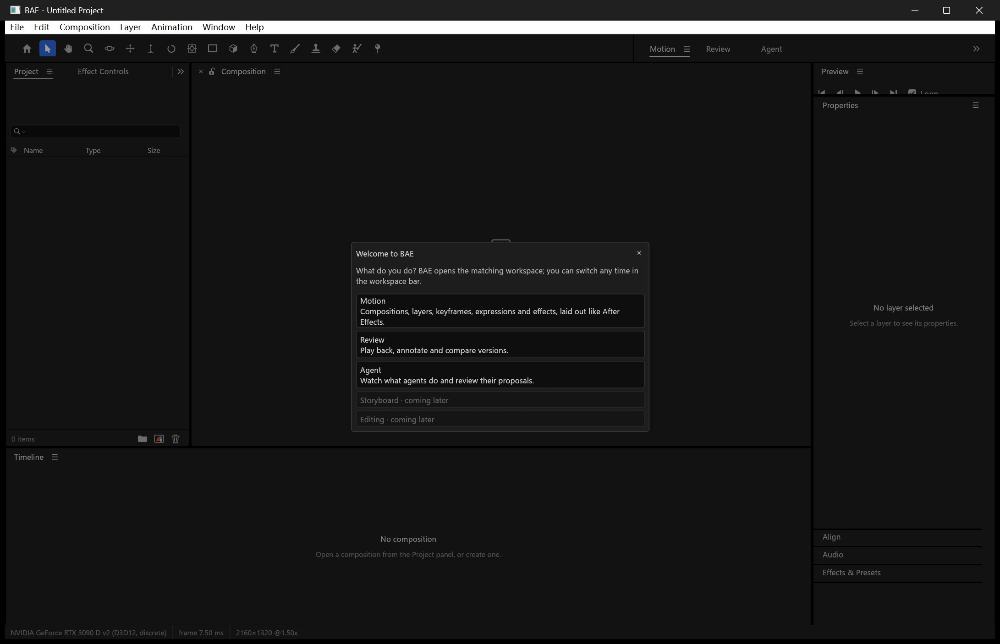
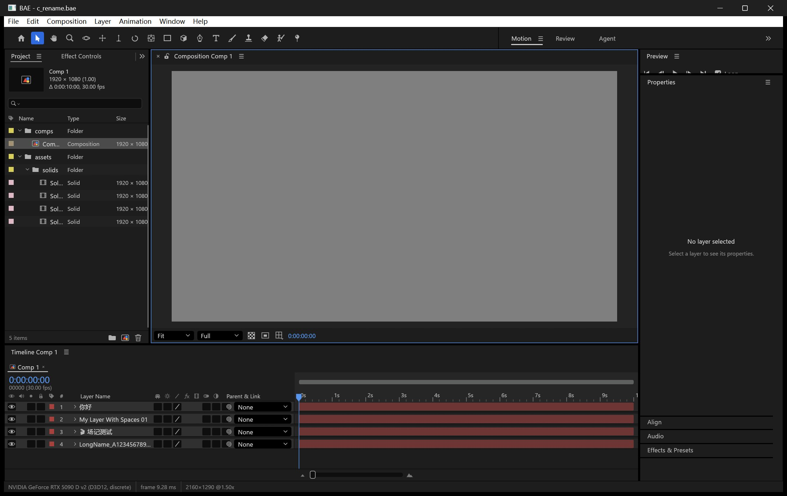

# Windows 实机：BAE 0.0.1 独立验收第二轮

## 环境信息

- **日期**：2026-11-21
- **分支 / 基线**：`origin/dev` @ **`fb08040ff6b0019763d1f941f87427af355d4af8`**（`fb08040`）
- **操作系统**：Microsoft Windows 11 专业版 10.0.26200（Build 26200，中文 zh-CN，`OSLanguage=2052`）
- **GPU**：NVIDIA GeForce RTX 5090 D v2（驱动 `32.0.16.1692`，D3D12）
- **显示 / DPI**：3840×2160，系统缩放 **150%**（`AppliedDPI=144`，窗口渲染 `@1.50x`）
- **构建**：`cargo build --release -p bae`（默认设置，未设 `WGPU_DX12_COMPILER`），`target/release/bae.exe` = **30,635,008 bytes（29.22 MB）**
- **输入法**：微软拼音（`0x8040804`）
- **操作与锁**：全程持有 `E:\bae-test\locks\gui.lock`（每 20 分钟刷新，测毕释放）；GUI 启动与操作经由 `orca computer`（`launch-app` / `get-app-state` / `press-key` / `hotkey` / `click` / `type-text`，`--restore-window`、`--screenshot-scale 1`）。

---

## 总表（A–H）

| 项 | 验收范围 | 结论 | 关联 Issue | 摘要 |
|---|---|---|---|---|
| **A** | 启动和欢迎框 | **通过** | — | 冷启动 0.94 s 弹出欢迎框；Esc、关闭按钮（×）、点框外均可关闭；Motion / Review / Agent 三个入口按钮均正确切换工作区；正常关闭后热启动 0.82 s 不再弹出欢迎框 |
| **B** | 新建合成、图层 ▸ 新建、菜单与快捷键 | **失败** | [#117](https://github.com/FELIXDAD/betterAfterEffect/issues/117), [#118](https://github.com/FELIXDAD/betterAfterEffect/issues/118) | 新建合成与 `Layer ▸ New` 全部 9 项图层创建及 `export-json` 均通过；无合成/有合成/有图层菜单置灰逻辑正确；`Edit ▸ Undo/Redo` 等 Shell 自有菜单项缺失快捷键显示（#117）；`Window` 菜单缺少 `Render Queue` 入口（#118）；`Ctrl+Shift+S` 在本机被系统全局热键占用（1409），归类为环境/自动化受限 |
| **C** | 时间轴改名（IME / 空格 / Emoji / 超长名） | **通过**（复现 [#106](https://github.com/FELIXDAD/betterAfterEffect/issues/106)、[#113](https://github.com/FELIXDAD/betterAfterEffect/issues/113)） | [#106](https://github.com/FELIXDAD/betterAfterEffect/issues/106), [#113](https://github.com/FELIXDAD/betterAfterEffect/issues/113) | 双击图层名触发行内改名；真实微软拼音 IME 组字选词（`ni'hao` → `你好`）、含空格名（物理空格键不触发播放）、Emoji（`🎬 场记测试`）、323 字符超长名全部正常显示且经保存—重开后与 `export-json` 逐字一致；另在 Windows 上复现并补充评论了已有 issue #106（Enter 不能改名/不全选原名）与 #113（重开工程不自动打开合成） |
| **D** | 关键帧、播放、焦点与撤销重做 | **通过** | — | 秒表与导航器 ◆ 打 3 个关键帧（0s/1s/2s）均确认 ◆ 变蓝并落盘；J/K 精准跳转；空格播放/停止在时间轴、查看器、项目、历史 4 个面板均生效，在项目搜索框与时间轴改名框中输入空格且不触发播放；连续 4 步图层与 3 步关键帧撤销/重做经 `export-json` 核验一致；选中关键帧后 `Animation` 菜单 5 项全部启用 |
| **E** | 保存和打开（边界与异常） | **失败** | [#126](https://github.com/FELIXDAD/betterAfterEffect/issues/126), [#111](https://github.com/FELIXDAD/betterAfterEffect/issues/111) | `.bae`/`.baez` 保存重开、`Ctrl+S`、脏关闭三键（取消 `Esc`/不保存 `N`/保存 `Y`）、空格路径、中文路径、只读目录报错不崩、命令行打开、`.baez` 另存覆盖确认均通过；Windows 另存为覆盖已存在的 `.bae` 文件夹时系统对话框直接进入该目录而非提示覆盖（#126）；损坏 `.baez` 报错透出 `Could not find EOCD`（复现并评论 #111） |
| **F** | 渲染队列（格式 / 停止 / 错误 / 满盘 / 多合成） | 待测（切 `763eaad` 后） | — | — |
| **G** | 语言（`BAE_LANG=zh` / `en`） | 待测（切 `763eaad` 后） | — | — |
| **H** | 150% DPI 清晰度与布局 | 待测（切 `763eaad` 后） | — | — |

> 说明：**A–E** 测于 `origin/dev` @ `fb08040`；**已有 issue 复测（#117/#118/#106/#107/#108/#110/#112/#114）与 F–H** 测于合并 #121 后的最新 `origin/dev`。

---

## A. 启动和欢迎框

**结论：通过**

测试前清空 `%LOCALAPPDATA%\BAE\State\` 下的 `workspaces.json` 与 `window.json` 以复现真实冷启动。

| 检查项 | 操作与验证方式 | 结果 | 实测现象与证据 |
|---|---|---|---|
| 冷启动 | 删除 `workspaces.json` / `window.json` 后 `orca computer launch-app bae.exe --activate` | **通过** | 0.94 s 出现主窗口 `BAE - Untitled Project`，弹出居中模态框 **Welcome to BAE**，状态栏显示 `NVIDIA GeForce RTX 5090 D v2 (D3D12, discrete) \| frame 7.68 ms \| 2160×1320 @1.50x`（见图 1） |
| 欢迎框 — Esc 关闭 | 欢迎框打开时按 `Escape` | **通过** | 模态框立即消失，停留在默认 `Motion` 工作区，界面可交互 |
| 热启动不再弹出 | 通过窗口关闭按钮正常退出，确认 `%LOCALAPPDATA%\BAE\State\workspaces.json` 已生成，再次启动 | **通过** | 0.82 s 打开主窗口，不再弹出欢迎框 |
| 欢迎框 — 关闭按钮（×） | 冷启动后 `Tab` ×1 聚焦右上角 `×` 按钮，按 `Enter` | **通过** | 模态框关闭，保留 `Motion` 工作区 |
| 欢迎框 — 点框外 | 冷启动后点击模态框外区域（窗口坐标 `150, 260`） | **通过** | 模态框关闭，背景区域（项目面板）正常响应焦点 |
| 三个入口按钮 — Motion | 冷启动后 `Tab` ×2 + `Enter` 选择 `Motion` | **通过** | 模态框关闭，`Motion` 工作区高亮（含 Project / Effect Controls、Composition、Timeline、Preview、Properties / Align / Audio / Effects & Presets） |
| 三个入口按钮 — Review | 冷启动后 `Tab` ×3 + `Enter` 选择 `Review` | **通过** | 模态框关闭，切换至 `Review` 工作区（大画幅 Composition、Timeline、Preview、History / Info） |
| 三个入口按钮 — Agent | 冷启动后 `Tab` ×4 + `Enter` 选择 `Agent` | **通过** | 模态框关闭，切换至 `Agent` 工作区（Composition、Timeline、Agent Activity、Proposals / History） |
| 未开放项置灰 | 观察 `Storyboard · coming later` 与 `Editing · coming later` | **通过** | 呈置灰不可点击状态，`Tab` 焦点自动跳过 |

---

## B. 新建合成、图层 ▸ 新建、菜单状态与快捷键

**结论：失败（bug：[#117](https://github.com/FELIXDAD/betterAfterEffect/issues/117)、[#118](https://github.com/FELIXDAD/betterAfterEffect/issues/118)）**

通过用户桌面 Win32 `GetMenuItemInfoW` 枚举全部菜单文本、快捷键字符串与启用状态，并在界面中逐一执行新建合成、新建 9 种图层及主要快捷键，最后保存至 `E:\bae-test\acc2\b_9layers.bae` 并用 `bae.exe export-json` 核验数据结构。

| 检查项 | 结果 | 实测现象与证据 |
|---|---|---|
| 新建合成（`Ctrl+N`） | **通过** | 创建 `Comp 1`（1920×1080，30.00 fps），标题变为 `BAE - Untitled Project *`，时间轴与查看器同步打开 |
| `Layer ▸ New` 全部 9 项 | **通过** | 经菜单逐一创建 `Text`、`Solid`、`Light`、`Camera`、`Null Object`、`Shape Layer`、`Adjustment Layer`、`Rectangle`、`Ellipse`，均无报错（见图 2）；单独验证 `Ellipse` 正确渲染为红色圆形（360×360）；`bae.exe export-json` 确认 9 层 `kind`（`text`/`solid`/`light`/`camera`/`null`/`shape`×3/`adjustment`）与 `solids` 资产完整落盘 |
| 无合成时 `Layer ▸ New` 置灰 | **通过** | `GetMenuItemInfoW` 实测无合成时 `Layer ▸ New` 下全部 9 项均为 `OFF`（`MFS_DISABLED`）；新建合成后全部变为 `ON` |
| 合成 / 动画 / 编辑 / 排列菜单可用状态 | **通过** | 无合成：`Trim Comp to Work Area`、`Add to Render Queue`、`Undo`/`Redo`、`Duplicate`/`Split Layer`、`Arrange` 4 项、`Animation` 5 项全 `OFF`；有合成无选中图层：`Composition` 3 项与 `Undo New Composition` 变为 `ON`，`Arrange`/`Duplicate`/`Split Layer`/`Animation` 仍 `OFF`；选中图层后：`Arrange` 4 项与 `Duplicate`/`Split Layer` 变为 `ON`，`Animation` 5 项因无选中关键帧仍 `OFF`（选中关键帧后的启用态将在 D 项一并复核） |
| 主要快捷键功能验证 | **通过**（`Ctrl+Shift+S` 自动化受限） | `Ctrl+N`（新建合成）、`Ctrl+Y`（新建纯色）、`Ctrl+D`（复制图层）、`Ctrl+Z`（撤销）、`Ctrl+Shift+Z`（重做）、`Ctrl+M`（加入渲染队列）、`Ctrl+S`（弹出 `Save As` 对话框并落盘）、`Ctrl+O`（弹出 `Open Project` 对话框，取消后 `IsWindowEnabled=True`）均生效；**`Ctrl+Shift+S` 自动化/环境受限**：经用户桌面 `RegisterHotKey(MOD_CONTROL\|MOD_SHIFT, 'S')` 确认返回 `ERROR_HOTKEY_ALREADY_REGISTERED (1409)`，被本机系统级热键拦截（`Ctrl+Shift+Z`/`Ctrl+Shift+D`/`Ctrl+S` 均空闲），非 BAE 缺陷 |
| 菜单显示快捷键与键位表一致性 | **失败（#117）** | 模块贡献项与 File 菜单项（`Ctrl+Alt+N` / `Ctrl+O` / `Ctrl+S` / `Ctrl+Shift+S` / `Ctrl+N` / `Ctrl+M` / `Ctrl+Y` / `Ctrl+D` / `Ctrl+Shift+D` / `F9` 等）显示一致；但 **`Edit ▸ Undo` 与 `Edit ▸ Redo` 未显示 `Ctrl+Z` / `Ctrl+Shift+Z`**（同属 Shell 硬编码的 `Keyboard Shortcuts`、`Exit` 及 `Window` 面板项也均缺失快捷键显示），已两次复现并提 [#117](https://github.com/FELIXDAD/betterAfterEffect/issues/117) |
| Window 菜单面板完整性 | **失败（#118）** | `Window` 菜单缺少 **`Render Queue`（渲染队列）** 入口（与 `render_queue.rs` 注释及 `Ctrl+Alt+0` 不一致），已提 [#118](https://github.com/FELIXDAD/betterAfterEffect/issues/118) |

---

## C. 时间轴改名

**结论：通过**

在 `Comp 1` 中创建 4 个纯色图层（`Solid 1`–`Solid 4`），通过双击时间轴 `Layer Name` 列触发行内改名（注：选中图层按 `Enter` 不触发改名，仅双击触发，`crates/bae-ui-motion/src/timeline.rs:1067`），逐一完成 4 类输入后保存为 `E:\bae-test\acc2\c_rename.bae`，关闭进程并以命令行重新打开该工程、双击项目面板中的 `Comp 1` 核验界面显示，同时以 `bae.exe export-json` 逐字比对落盘值。

| 检查项 | 操作与验证方式 | 结果 | 实测现象与证据 |
|---|---|---|---|
| 真实中文输入法组字 | 双击第 1 行图层名，确认微软拼音处于中文输入态（`IMC_GETOPENSTATUS=1`，`IMC_SETCONVERSIONMODE=1`），发送真实物理按键 `n i h a o`，截图确认预编辑 `ni'hao` 与微软拼音候选框 `1 你好 2 你号 ...` 正确跟随光标弹出（见图 3），按 `1` 选词再按 `Enter` 提交 | **通过** | 预编辑、候选框定位、选词上屏与回车提交均顺畅，图层名成功改为 `你好` |
| 含空格图层名 | 双击第 2 行图层名，使用物理 `Space` 键与文本输入 `My Layer With Spaces 01` 后按 `Enter` | **通过** | 空格正常输入为字符，时间码保持 `0:00:00:00` 未误触发播放 |
| Emoji 图层名 | 双击第 3 行图层名，输入 `🎬 场记测试` 后按 `Enter` | **通过** | 场记板 Emoji 正常渲染（无乱码/方框），中文同显正常 |
| 超长图层名（>300 字符） | 双击第 4 行图层名，输入 323 字符名称（`LongName_` + 31×`A123456789` + `_END`）后按 `Enter` | **通过** | 无崩溃、无卡顿，时间轴 `Layer Name` 列按列宽自动截断为 `LongName_A123456789...`，不挤占右侧开关与 Parent 列 |
| 保存—关闭—重开持久化 | `Ctrl+S` 保存至 `c_rename.bae`，关闭并重开工程，核对界面（见图 4）与 `bae.exe export-json` | **通过** | 4 个图层名在界面与 `export-json` 中均 100% 逐字一致：`/comps/Comp_1/layers/Solid_4`=`"你好"`（len=2）、`Solid_3`=`"My Layer With Spaces 01"`（len=23）、`Solid_2`=`"🎬 场记测试"`（len=6）、`Solid_1` 完整保留 323 字符 |

> 附注（已有 issue 跨平台复现）：测试中同时复现了 [#106](https://github.com/FELIXDAD/betterAfterEffect/issues/106)（时间轴选中图层按 `Enter` 不能开始改名；双击进入改名框后未全选原名）和 [#113](https://github.com/FELIXDAD/betterAfterEffect/issues/113)（重开工程后未自动打开合成），均已在原 issue 下补充 Windows 实机复现评论，未重复开 issue。

---

## D. 关键帧、播放、焦点与撤销重做

**结论：通过**

在 `Comp 1` 中创建 `Solid 1` 并按 `P` 展开 `Position`，全程点击秒表与关键帧导航器 `◆` 打帧（避开中文输入法可能吞掉的 `Alt+Shift+*`），逐帧以像素检测确认导航器 `◆` 蓝像素数（无帧 0 px → 有帧 85 px），并结合时间码截图与 `bae.exe export-json` 核验。

| 检查项 | 操作与验证方式 | 结果 | 实测现象与证据 |
|---|---|---|---|
| 秒表打关键帧（0s） | 点击 `Position` 秒表 `(228, 1162)` | **通过** | 秒表与左侧导航器 `◆` `(48, 1163)` 均变蓝（蓝像素 85 px），时间轴轨道 `0s` 出现菱形关键帧 |
| 导航器 ◆ 打关键帧（1s / 2s） | `Shift+PageDown` ×3 跳至 `0:00:01:00`（`◆` 变灰，蓝像素 0）→ 点 `◆`（变蓝 85 px）；再跳至 `0:00:02:00`（`◆` 变灰，0）→ 点 `◆`（变蓝 85 px）（见图 5） | **通过** | 3 个关键帧（`0` / `705600000` / `1411200000` ticks）均精确写入 `transform:position.keyframes` |
| 选中关键帧后 `Animation` 菜单状态（补测 B） | 单击轨道 `2s` 关键帧菱形选中后 `GetMenuItemInfoW` 枚举 | **通过** | `Animation ▸ Keyframe Assistant` 4 项（`Easy Ease`、`Easy Ease In`、`Easy Ease Out`、`Time-Reverse Keyframes`）与 `Toggle Hold Keyframe` 全部由灰变为启用 |
| `J` / `K` 在关键帧之间跳转 | 从 `0:00:02:00` 依次按 `J`、`J`、`K`、`K` | **通过** | 时间码精准依次跳转：`0:00:01:00` → `0:00:00:00` → `0:00:01:00` → `0:00:02:00`，每次跳转后 `◆` 均为蓝色（85 px） |
| 空格播放 / 停止 — 4 面板焦点 | 依次点击聚焦 **时间轴**、**合成查看器**、**项目面板**、**历史面板**（通过 `Window ▸ History` 打开），`Home` 归零后 `Space` 播放 ~0.6 s 再 `Space` 停止，停后等待 0.4 s 复核时间码静止 | **通过** | 4 个面板焦点下均正常起播并立即停止：Timeline `0:00:00:00 → 0:00:01:07` 静止；Composition / Project / History 均 `0:00:00:00 → 0:00:01:05` 静止（停后 0.4 s 像素差为 0） |
| 空格 — 文本框焦点不播放 | 1) 点击项目面板搜索框，输入 `foo` + 物理 `Space` + 等 0.55 s + `bar`；2) 时间轴改名框（C 项）输入含空格名 | **通过** | 搜索框清晰显示 `foo bar`，时间码始终保持 `0:00:00:00`（像素差 0），不触发播放 |
| 连续撤销与重做（图层 + 关键帧） | 1) 连续 4 次图层操作（`Ctrl+Y` / `Ctrl+Y` / `Ctrl+D` / `Ctrl+Y`，4→8 层）→ `Ctrl+Z` ×4 → `Ctrl+Shift+Z` ×4；2) 3 个关键帧 → `Ctrl+Z` ×3 → `Ctrl+Shift+Z` ×3；每步保存后用 `export-json` 核对 | **通过** | 图层：`8 层 → 4 层 → 8 层` 完全一致；关键帧：`3 帧（0/1s/2s）→ 0 帧（纯静态值）→ 3 帧（0/1s/2s）` 完全一致 |

---

## E. 保存和打开

**结论：失败（新提 bug：[#126](https://github.com/FELIXDAD/betterAfterEffect/issues/126)；复现并评论已有 bug：[#111](https://github.com/FELIXDAD/betterAfterEffect/issues/111)）**

本节全部用例均测于 `origin/dev` @ `fb08040`，结果均经 Win32 对话框检查、`IsWindowEnabled` 与 `bae.exe export-json` 核对。

| 检查项 | 操作与验证方式 | 结果 | 实测现象与证据 |
|---|---|---|---|
| `.bae` 与 `.baez` 保存/重开 | 新建工程保存为 `e_test.bae`，`File ▸ Save As...` 保存为 `e_test.baez`（确认合法 zip），再命令行打开 `.baez` 增层并 `Ctrl+S` | **通过** | `.bae` 与 `.baez` 均可读写；`.baez` 增层保存后 `export-json` 确认 `['Solid 3', 'Solid 2', 'Solid 1']` |
| `Ctrl+S` 增量保存 | 打开 `e_test.bae`（1 层）后增层（标题变 `BAE - e_test.bae *`），按 `Ctrl+S` | **通过** | 无弹窗直接原地保存，标题 `*` 清除，`export-json` 更新为 `['Solid 2', 'Solid 1']` |
| 脏关闭提示 — 取消（`Esc`） | 修改 `e_test.bae`（新增 `Comp 2`，标题带 `*`）→ `File ▸ Exit` 弹出 `Save changes to “e_test.bae” before closing?`（`是(Y)` / `否(N)` / `取消`）→ 按 `Esc` | **通过** | 弹窗关闭，主窗口保留运行（`IsWindowEnabled=True`，标题仍 `BAE - e_test.bae *`），磁盘仍为 `['Comp_1']` |
| 脏关闭提示 — 不保存（`N`） | 再次 `File ▸ Exit` → 按 `N` | **通过** | 进程正常退出，磁盘 `export-json` 仍为 `['Comp_1']`（未保存 `Comp_2`） |
| 脏关闭提示 — 保存（`Y`） | 重开 `e_test.bae`，新增 `Comp 2` → `File ▸ Exit` → 按 `Y` | **通过** | 进程正常退出，磁盘 `export-json` 更新为 `['Comp_1', 'Comp_2']` |
| 路径带空格 | 另存为 `E:\bae-test\acc2\dir with space\proj with space.bae`，命令行重新打开并用 `export-json` 核对 | **通过** | 成功保存并重开，标题 `BAE - proj with space.bae`，`export-json` 完整包含 2 层 |
| 路径带中文 | 另存为 `E:\bae-test\acc2\中文目录\测试工程.bae` 与 `测试工程.baez`，均命令行重开并 `export-json` 核对 | **通过** | `.bae` 与 `.baez` 均保存与重开正常，标题无乱码，`export-json` 核验一致 |
| 保存到只读目录 | 1) `icacls /deny` 只读目录 `Save As`：系统对话框提示无写权限；2) 打开只读目录内 `locked.baez` 与 `locked.bae` 后修改并 `Ctrl+S` | **通过** | BAE 弹出明确错误弹窗（`.baez` 报 `Could not save the project... 拒绝访问。 (os error 5)`，`.bae` 报 `os error 183`），不崩溃；点确定后 `IsWindowEnabled=True`，标题仍带 `*`，内存工程未丢失 |
| 另存为覆盖已存在文件 — `.baez` | 另存为覆盖磁盘已有 1 层 `e_ow_clean.baez` | **通过** | 弹出系统 `确认另存为`（`是(Y)` / `否(N)`），按 `Y` 确认后 `export-json` 更新为新工程 2 层 |
| 另存为覆盖已存在工程 — `.bae` | 另存为覆盖磁盘已有 `e_ow.bae` / `e_ow2.bae` 目录（复现两次） | **失败（#126）** | 因 `.bae` 在 Windows 上为普通文件夹，`IFileSaveDialog` 点击 `保存(S)` 后**直接进入该目录内部**（地址栏变为 `地址: E:\bae-test\acc2\e_ow2.bae`），既不提示覆盖也不写入，已提 [#126](https://github.com/FELIXDAD/betterAfterEffect/issues/126) |
| 打开损坏文件（`.bae` / `.baez`） | 1) 在已打开工程中通过 `File ▸ Open` 打开非 zip 垃圾 `.baez`；2) 命令行分别启动截断 `project.json` 的 `.bae` 与损坏 `.baez` | **部分通过 / 复现 #111** | 均弹出错误弹窗、不崩溃、GUI 下原打开工程保持不受影响；但错误文案直接暴露底层 `zip: invalid Zip archive: Could not find EOCD` 与 serde 行列报错，已在 [#111](https://github.com/FELIXDAD/betterAfterEffect/issues/111) 下补充 Windows 复现评论 |
| 命令行 `bae.exe <工程>` 打开 | 依次用命令行打开 `.bae`、`.baez`、空格路径与中文路径工程 | **通过** | 全部正常启动并加载对应工程 |

