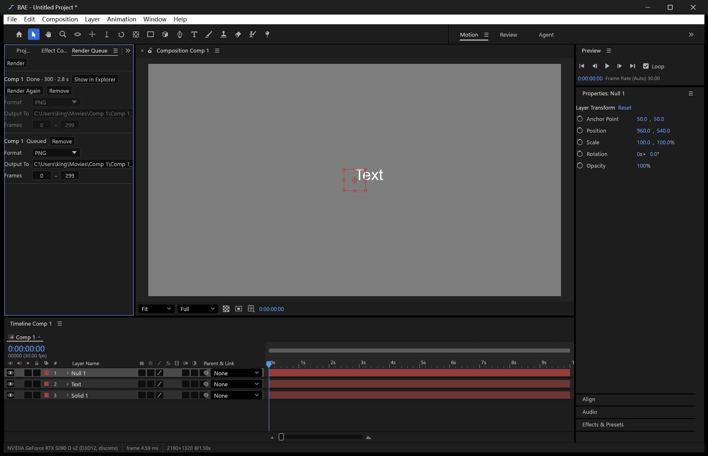
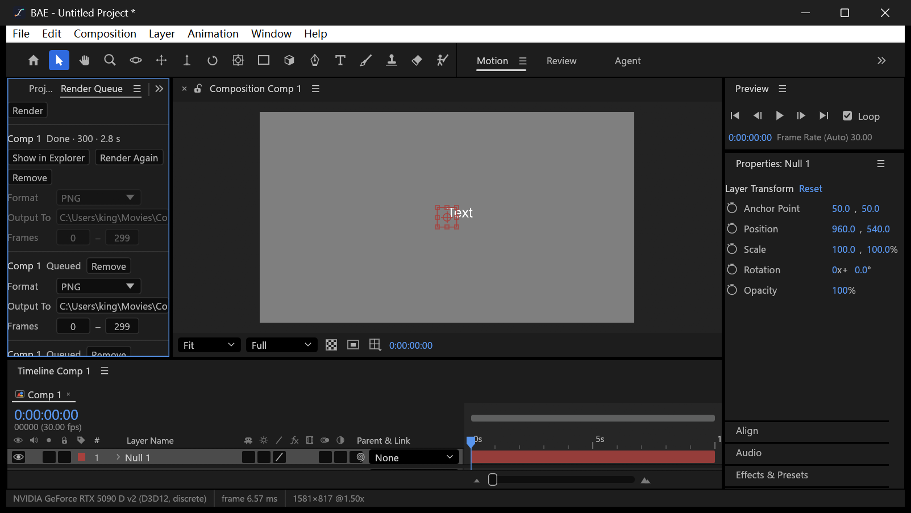
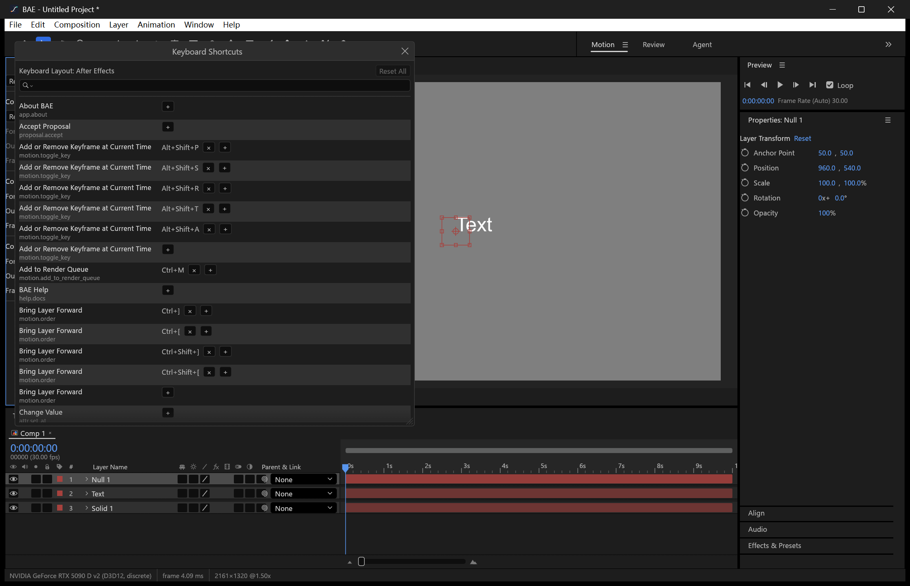
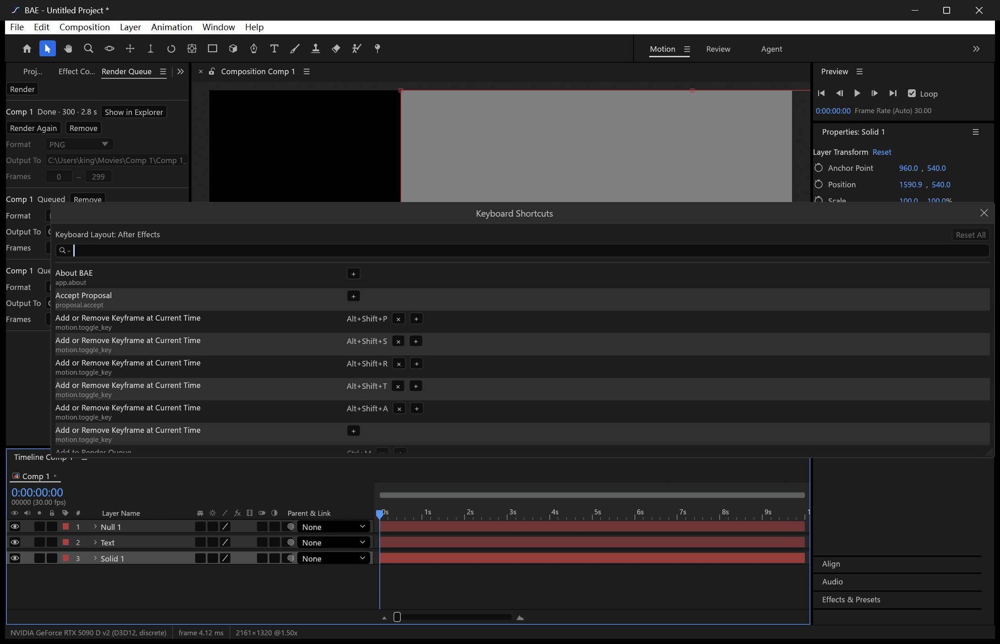
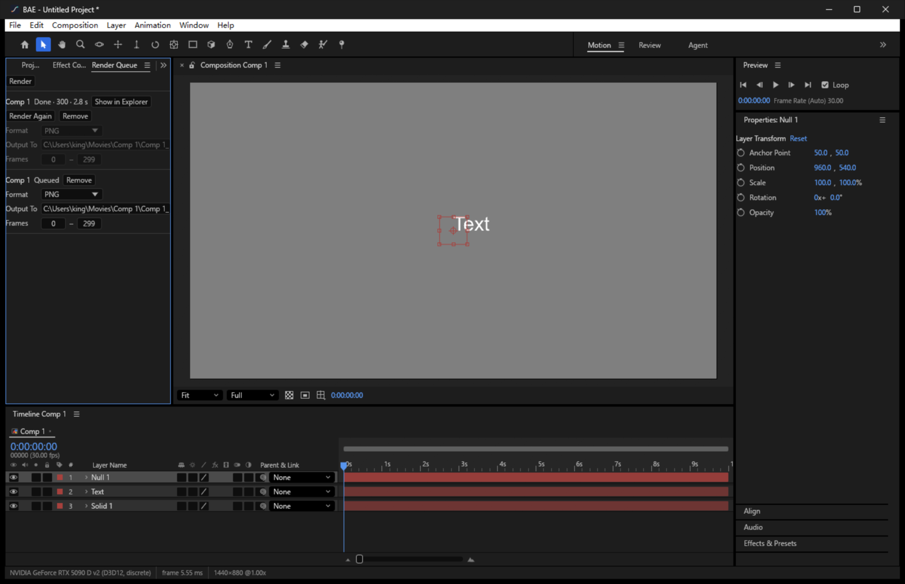

# Windows 实机复测：高 DPI 默认布局与快捷键对话框（#133、#134 / PR #141）

- 日期：2026-11-21
- 机器：Windows 11 + **NVIDIA GeForce RTX 5090 D v2**（D3D12），主显示器（显示器 2）3840×2160 横向
- BAE：`origin/dev` @ **`af27424`**（`af2742493def8238a9daa097f800c82d701de3e8`，`Merge pull request #141 from FELIXDAD/ui/dpi-layout`）
- 构建：`cargo build --release -p bae` → `target/release/bae.exe`（31,277,056 bytes）
- 设置：**默认设置**（默认英文界面，每次切换缩放后清空 `%LOCALAPPDATA%\BAE\State\{window,workspaces}.json` 冷启动验证默认布局）
- 操作与锁：整个 GUI 测试期间持 `E:\bae-test\locks\gui.lock`（测毕已释放）；全部启动、点击、按键、拖拽与截图通过 `orca computer`（`launch-app --activate` / `get-app-state` / `click` / `hotkey` / `press-key` / `drag` / `scroll` / `perform-secondary-action`）操作 UIA 节点完成。
- 截图：[`dpi-retest-shots/`](./dpi-retest-shots/)（共 6 张，均为 BAE 窗口，单张 137–260 KB，均 ≤ 400 KB）

## 复测结论总表（`dev` @ `af27424`）

| Issue | 缩放档位 | 客户端尺寸 / 缩放 | 结果 | 关键验证点 |
|---|---|---|---|---|
| #133 默认布局 | **150%（默认窗口）** | `2160×1320 @1.50x` | **通过** | Preview 播放控制栏与 Loop、时间码完整；Render Queue 在左栏自动换行（`Show in Explorer` / `Render Again` / `Remove` 无裁切）；Project 底栏完整在面板内；左栏 3 页签收紧后可读（`Proj...` / `Effect Co...` / `Render Queue`） |
| #133 默认布局 | **150%（缩小主窗口）** | `1581×817 @1.50x`（窗口 `1603×903`） | **通过** | Preview 仍完整无裁切；Render Queue 按钮自动折为两行无右边界裁切，3 项队列触发垂直滚动条（UIA `滚动条` 激活）并可滚动；左栏页签自动保留活动页签并将溢出页签收入 `>>`；Project 底栏仍完整在面板内 |
| #134 快捷键对话框 | **150%** | `2161×1320 @1.50x` | **通过** | 左侧命令列按内容定宽，长命令名（如 `Add or Remove Keyframe at Current Time`、`Accept Proposal`）全部单行无断词；快捷键列紧随其后、右侧不再大片空白；拖拽边框可调整宽高且列宽与斑马纹随之合理变化；`Esc` 可关闭对话框 |
| #133 & #134 | **125%（默认窗口）** | `1800×1100 @1.25x` | **通过** | 无需注销即实时生效（Per-Monitor V2 DPI）；Preview、Render Queue 左栏换行、Project 底栏、页签收紧与快捷键对话框均正常 |
| #133 & #134 | **100%（默认窗口）** | `1440×880 @1.00x` | **通过** | 无需注销即实时生效；Preview、Render Queue 左栏换行、Project 底栏、页签收紧与快捷键对话框均正常 |

**整体判定**：#133 与 #134 在 Windows 5090 实机 **150% / 125% / 100%** 全部复测**通过**。

---

## 逐项实测记录与证据

### 1. 150% 缩放：默认窗口与缩小主窗口（#133）

1. **默认窗口（`2160×1320 @1.50x`，外框 `2182×1406`）**：
   - 清空 `%LOCALAPPDATA%\BAE\State\{window,workspaces}.json` 冷启动 BAE，选择 `Motion` 工作区，新建 `Comp 1`，依次添加 `Solid 1`、`Text`、`Null 1` 三个图层；聚焦左栏 `Project` 后按 `Ctrl+M` 将 `Comp 1` 加入停靠在左栏的 `Render Queue`，完成一次 300 帧渲染（`Done · 300 · 2.8 s`）再按 `Ctrl+M` 增加一条 `Queued` 项。
   - **Preview 面板**：播放控制栏（`First Frame` / `Previous Frame` / `Play/Stop` / `Next Frame` / `Last Frame` / `Loop` 复选框）以及下方 `0:00:00:00 Frame Rate (Auto) 30.00` 完整显示，不再被下方 Properties 面板拦腰截断。
   - **Render Queue 面板（窄左栏）**：`Done` 条目头部 `Show in Explorer` 在首行，`Render Again` 与 `Remove` 自动换行到第二行，全部完整可见且可点击，无右边界裁切；`Output To` 输入框边界位于面板内。
   - **左栏页签栏**：`Proj...`、`Effect Co...`、`Render Queue ≡` 三个页签全部留在页签栏中，活动页签完整显示，非活动页签收紧为省略号后仍可读。
   - **Project 面板底栏**：切回 `Project` 页签目视确认底部 `2 items` 与新建文件夹 / 新建合成 / 删除三个按钮均完整位于面板底边以内，无越界裁切。

2. **缩小主窗口至 `1603×903`（客户端 `1581×817 @1.50x`，逻辑约 `1054×545`）**：
   - 拖拽主窗口右下角将窗口缩小至 `1603×903`，再按 `Ctrl+M` 增加第 3 条队列项：
   - **Render Queue**：按钮在更窄宽度下折为 `[Show in Explorer] [Render Again]` + `[Remove]` 两行，无右边界裁切；3 条队列超出面板高度后自动出现滚动条（UIA 树检出 `滚动条` 节点），滚轮可滚动查看底部条目；放大窗口恢复空间后滚动条自动收回。
   - **Preview**：即使在 `1581×817 @1.50x` 下，最小尺寸保护仍使整行播放按钮、`Loop` 与时间码保持完整不裁切。
   - **页签栏与 Project 底栏**：窄宽度下保留活动页签 `Render Queue` 完整并将 `Effect Controls` 收进 `>>` 菜单，非活动页签 `Proj...` 可读；切回 `Project` 时底栏 `2 items` 与三枚图标仍完整位于面板内。

---

### 2. 150% 缩放：键盘快捷键对话框（#134）

1. **默认打开状态（`Edit ▸ Keyboard Shortcuts` / `Ctrl+Alt+'`）**：
   - 左侧命令列按内容宽度分配，长命令名（`Add or Remove Keyframe at Current Time`、`Accept Proposal`、`Add to Render Queue`、`Bring Layer Forward` 等）及其下方命令 ID 均为单行显示，不再出现逐字折行断词。
   - 快捷键列紧跟命令列之后，斑马纹铺满整行，右侧无大片空白浪费；按 `Esc` 可直接关闭对话框。

2. **拖拽边框调整大小**：
   - 拖拽对话框下边框（UIA 调整句柄 `790`）将高度由约 930 px 缩至约 550 px，再拖拽左边框（UIA 调整句柄 `794`）将宽度由默认 964 px 拉宽至约 2060 px：
   - 对话框尺寸实时跟随变化，命令列宽随窗口宽度按比例合理收放、单行不折行，快捷键列与整行斑马纹随之适配。

---

### 3. 125% 与 100% 缩放复测（#133、#134）

通过 Windows 设置（`系统 ▸ 屏幕 ▸ 缩放`，选中 3840×2160 主显示器即显示器 2）依次切换缩放为 **125%** 与 **100%**。BAE 具备 Per-Monitor V2 DPI 感知，**无需注销**，完全退出后清空状态冷启动即分别以 `@1.25x` 与 `@1.00x` 运行。

1. **125% 缩放（`1800×1100 @1.25x`）**：
   - Preview 播放控制栏与时间码完整无裁切；Render Queue 停靠左栏时 `Done` 条目按钮自动换行无裁切；左栏三页签（`Proj...` / `Effect Co...` / `Render Queue` 及切回 Project 后的 `Project` / `Effect Con...` / `Render Q...`）全部留在栏内且可读；Project 底栏完整在面板内；快捷键对话框命令列单行无断词、布局紧凑。

2. **100% 缩放（`1440×880 @1.00x`）**：
   - Preview 播放控制栏与时间码完整无裁切；Render Queue 停靠左栏时按钮自动换行无裁切；左栏三页签全部留在栏内且可读；Project 底栏完整在面板内；快捷键对话框命令列单行无断词、布局紧凑。

---

### 4. 系统缩放恢复确认

全部复测完成后已退出 BAE，并在 Windows 设置（`系统 ▸ 屏幕 ▸ 缩放`）中将主显示器（显示器 2，`3840 × 2160 (推荐)`）恢复为 **`150% (推荐)`**，双途径验证如下：
- Windows 设置 UIA 状态：`组合框 缩放` = **`150% (推荐)`**，`显示器分辨率` = `3840 × 2160 (推荐)`；
- PowerShell（新进程 `SetProcessDpiAwarenessContext(PER_MONITOR_AWARE_V2)`）查询结果：
  - `GetDpiForMonitor(Primary)` = **`144×144 (150%)`**
  - `GetDpiForSystem()` = **`144 (150%)`**
  - 注册表 `HKCU:\Control Panel\Desktop\WindowMetrics\AppliedDPI` = **`144`**
- 资源锁 `E:\bae-test\locks\gui.lock` 已释放。
