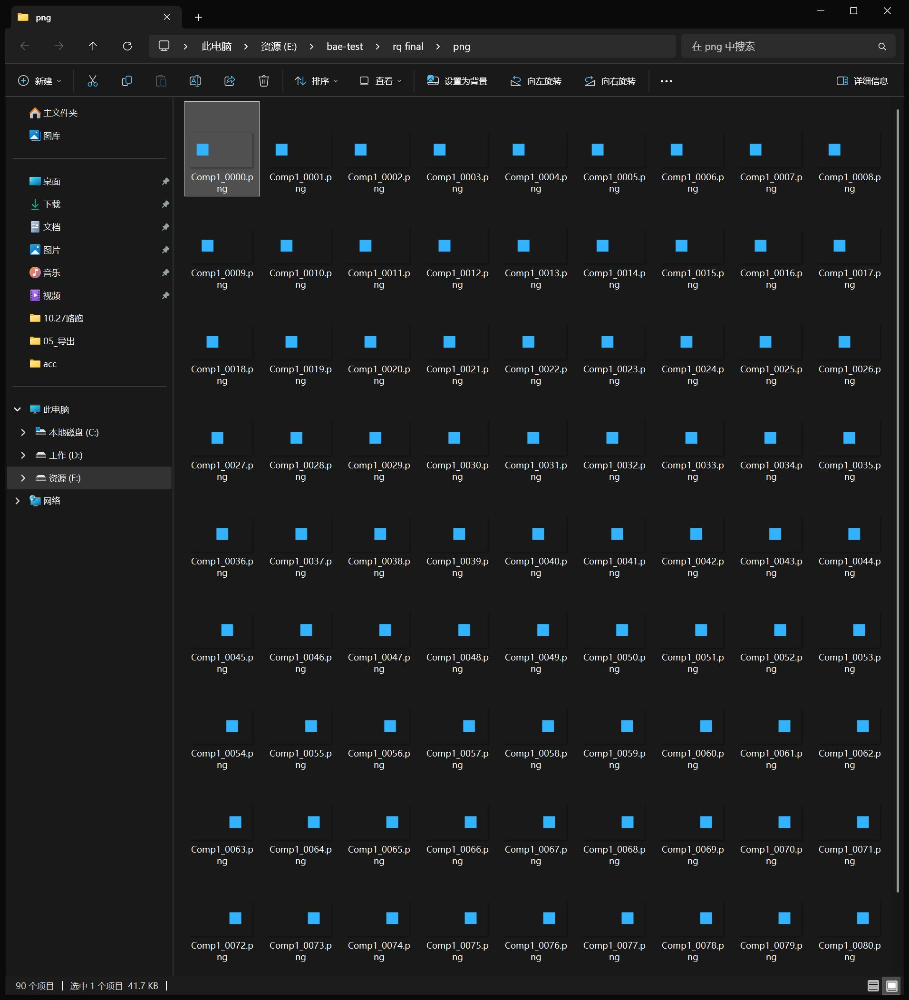
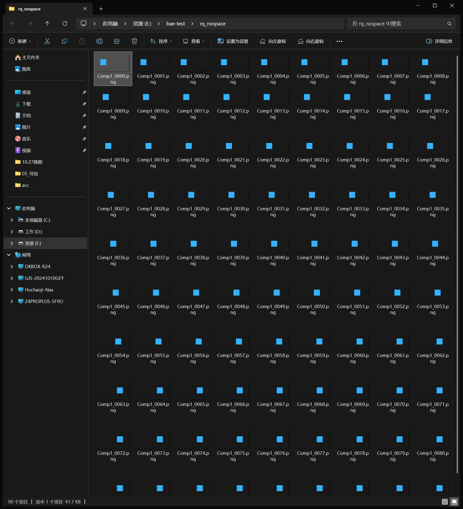
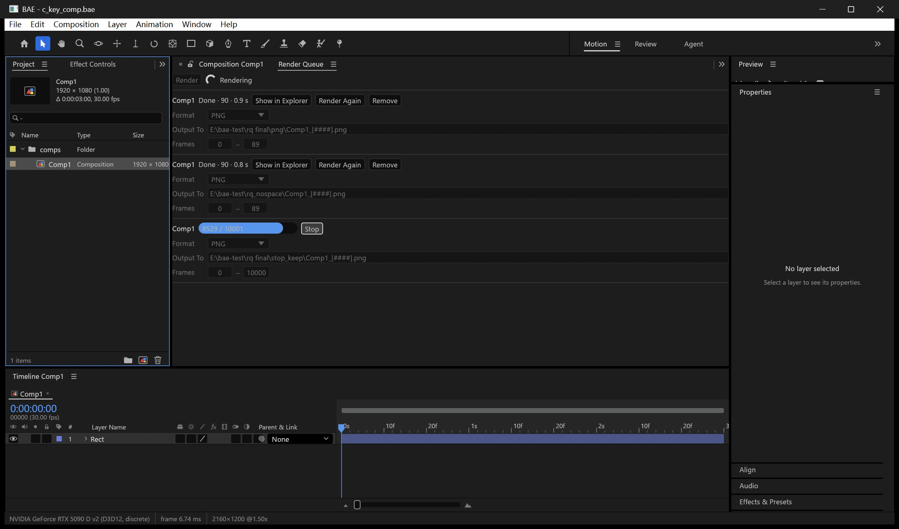
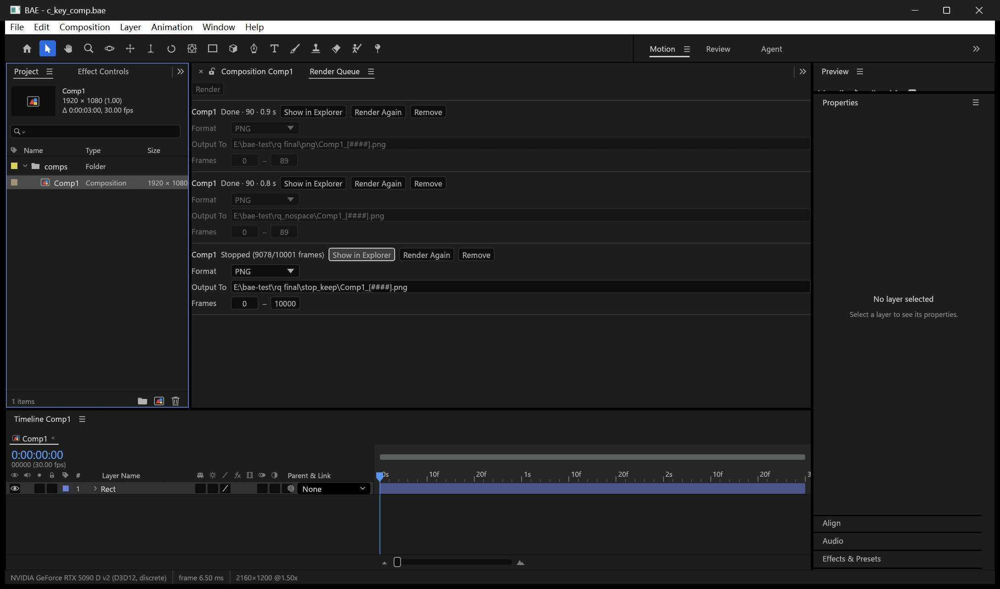

# Windows 实机：0.0.1 最终验收 — C 渲染队列三项修复复测（#103 `render/queue-fixes`）

- 日期：2026-11-21
- 机器：Windows 11 + **NVIDIA GeForce RTX 5090 D v2**（D3D12），20 逻辑核，2160×1200 @1.50x
- BAE：`origin/dev` @ **`5819881`**（`58198810bbf40d40a5183242c95a88b622fa0cec`，`Merge pull request #103 from FELIXDAD/render/queue-fixes`，修复提交 `d7d0230`）
- 构建：`cargo build --release -p bae` → `target/release/bae.exe`（30,635,008 bytes）
- 设置：**默认**（未设 `WGPU_DX12_COMPILER`，默认英文界面）
- 素材与操作：复用 `E:\bae-test\acc\c_key_comp.bae` 与 `launch_c_key.bat`；实测期间持 `gui.lock`（测毕已释放）；全部启动、按键与截图通过 `orca computer`（`launch-app` / `get-app-state` / `click` / `press-key` / `hotkey` / `type-text`，`--restore-window`、`--screenshot-scale 1`），按钮一律 `Tab` / `Shift+Tab` 聚焦后按 `Enter` 触发。
- 截图：[`c-fixes-shots/`](./c-fixes-shots/)（共 4 张，单张 177–325 KB，均 ≤ 400 KB）

## 复测总结表（#103 三项修复 @ `5819881`）

| 编号 | 复测项 | 结果 | 一句话结论 |
|---|---|---|---|
| 1 | 在资源管理器中显示（含空格 + 无空格路径） | **通过** | `E:\bae-test\rq final\png\`（90 帧，0.9 s）与 `E:\bae-test\rq_nospace\`（90 帧，0.8 s）在 `Tab` 聚焦 `Show in Explorer` 按 `Enter` 后，均精确打开对应输出目录并选中首帧 `Comp1_0000.png`（状态栏 `90 个项目 \| 选中 1 个项目 41.7 KB`，COM `SelectedItems()` = 1） |
| 2 | 停止按钮的 `Enter` 不再触发项目面板改名 | **通过** | 先点击项目面板 `Comp1` 使其持有蓝色停靠焦点与选中态，渲染中 `Tab` 聚焦 `Stop` 按 `Enter` 后仅停止渲染，项目面板保持 `Comp1` 选中且未进入行内改名（对照：随后 `Esc` 清控件焦点再按 `Enter` 仍正常触发 `Comp1` 行内改名） |
| 3 | 停止后保留已渲出的帧且计数一致 | **通过** | 10,001 帧（`0 – 10000`）PNG 渲染中途 `Tab + Enter` 停止，界面显示 **`Stopped (9078/10001 frames)`**（附 `Show in Explorer` / `Render Again` / `Remove`），磁盘 `E:\bae-test\rq final\stop_keep\` 实留 **`9,078`** 个完整 PNG（`Comp1_0000.png`–`Comp1_9077.png`，每帧 42,790–42,816 B，无半成品），`N` 与磁盘文件数 100% 一致 |

**整体判定**：#103（`render/queue-fixes`）三项修复在 Windows 5090 实机 **3/3 全部通过**；结合 `293561a` 上已通过的其余 6 项，**C 渲染队列全项闭环通过**。

---

## 逐项实测记录与证据

### 1. 在资源管理器中显示（含空格路径与无空格路径）

说明：本机 agent 命令行处于隔离桌面，Win32 `EnumWindows` 看不到用户桌面的 `CabinetWClass` 窗口（返回空列表）；故同时使用 `Shell.Application` COM（核对真实用户桌面窗口 `HWND`、`LocationURL`、`Document.SelectedItems()` / `FocusedItem`）与 `orca computer list-windows` + `get-app-state` 对新建 Explorer 进程直接截图验证。每次触发前均清理输出目录并关闭前次测试 Explorer 窗口（既有基线窗口为 `0x80916 此电脑` 与 `0x609A4 自动驾驶：前夜`）。

- **含空格路径 `E:\bae-test\rq final\png\`**：
  - `Ctrl+M` 将 `Comp1` 加入队列，`Output To` 键入 `E:\bae-test\rq final\png\Comp1_[####].png`，`Shift+Tab` ×3 聚焦 `Render` 按 `Enter` 完成渲染（面板 `Done · 90 · 0.9 s`，磁盘 90 帧 `Comp1_0000.png`–`Comp1_0089.png`）。
  - `Tab` 聚焦第 1 项 `Show in Explorer` 按 `Enter`：
    - `Shell.Application` 检出新增 Explorer 窗口 `HWND=0x2461350`（`png - 文件资源管理器`，PID `55988`），`LocationURL = file:///E:/bae-test/rq%20final/png`；
    - `Document.SelectedItems().Count = 1`，选中项为 **`E:\bae-test\rq final\png\Comp1_0000.png`**（`FocusedItem` 一致）；
    - Explorer 实机截图见图 1：地址栏显示 `此电脑 > 资源 (E:) > bae-test > rq final > png`，`Comp1_0000.png` 高亮选中，状态栏显示 `90 个项目 | 选中 1 个项目 41.7 KB`（不再退回「文档」）。

- **无空格路径 `E:\bae-test\rq_nospace\`**：
  - `Ctrl+M` 新增第 2 项，`Output To` 键入 `E:\bae-test\rq_nospace\Comp1_[####].png`，`Shift+Tab` ×6 聚焦 `Render` 按 `Enter` 完成渲染（面板 `Done · 90 · 0.8 s`，磁盘 90 帧 `Comp1_0000.png`–`Comp1_0089.png`）。
  - `Tab` 聚焦第 2 项 `Show in Explorer` 按 `Enter`：
    - `Shell.Application` 检出新增 Explorer 窗口 `HWND=0x881522`（`rq_nospace - 文件资源管理器`，PID `57116`），`LocationURL = file:///E:/bae-test/rq_nospace`；
    - `Document.SelectedItems().Count = 1`，选中项为 **`E:\bae-test\rq_nospace\Comp1_0000.png`**；
    - Explorer 实机截图见图 2：地址栏显示 `此电脑 > 资源 (E:) > bae-test > rq_nospace`，`Comp1_0000.png` 高亮选中，状态栏显示 `90 个项目 | 选中 1 个项目 41.7 KB`。

---

### 2. 停止按钮的 `Enter` 不再触发项目面板改名 & 3. 停止后保留已渲出的帧

- **准备长范围队列与项目面板停靠焦点**：
  - `Ctrl+M` 新增第 3 项，设 `Output To` 为 `E:\bae-test\rq final\stop_keep\Comp1_[####].png`、`Frames` 为 `0 – 10000`（共 **10,001** 帧）。
  - 先单击项目面板中的 **`Comp1`**，使项目面板持有蓝色停靠焦点框且 `Comp1` 处于选中态；再经项目搜索框 `Tab` ×14 移焦点至 `Render` 按钮（不点击渲染队列面板，蓝色停靠焦点框始终停留在项目面板）按 `Enter` 开始渲染。
- **渲染中途 `Tab` 到 `Stop` 按 `Enter`**：
  - 渲染启动后 1.5 s 磁盘已写出 576 帧；在项目面板保持蓝色停靠焦点和 `Comp1` 选中态下，`Tab` ×20 聚焦第 3 项的 **`Stop`** 按钮（见图 3：此时进度 `8529 / 10001`，界面帧耗时 `6.74 ms` 不卡顿，项目面板蓝色停靠边框与 `Comp1` 选中态均清晰可见）。
  - 按 `Enter` 触发 `Stop`（见图 4）：
    - **复测 2 验证**：渲染立即停止；左侧项目面板仍持有蓝色停靠焦点框与 `Comp1` 选中态，**未进入行内重命名**（无文本输入框）。作为正对照，随后按 `Esc` 清除按钮焦点后再按一次 `Enter`，项目面板立刻对 `Comp1` 开启行内重命名（再按 `Esc` 取消），证明全过程项目面板确实持有停靠焦点，且 `#103` 的 `panel_key_pressed` 准确拦截了按钮消费的 `Enter`。
    - **复测 3 验证**：第 3 项状态显示 **`Stopped (9078/10001 frames)`**（中文语言下对应 `已停止（9078/10001 帧）`），并附 `Show in Explorer` / `Render Again` / `Remove` 按钮；于停止后 +2 s 与 +4 s 两次清点 `E:\bae-test\rq final\stop_keep\`：
      - 目录内总条目数 = **9,078**，PNG 文件数 = **9,078**（`Comp1_0000.png` 至 `Comp1_9077.png` 连续无缺号）；
      - 文件体积范围 `42,790 – 42,816 B`（无 0 字节或半成品文件）；
      - 界面显示的 `N = 9078` 与磁盘实存文件数 **9,078** 完全一致。

