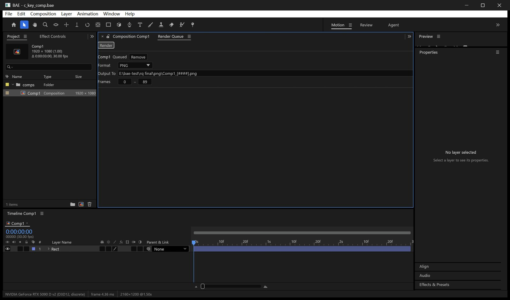
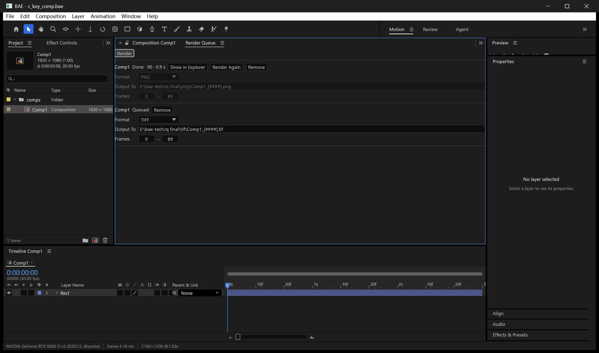
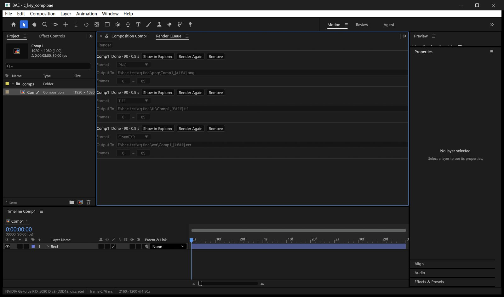
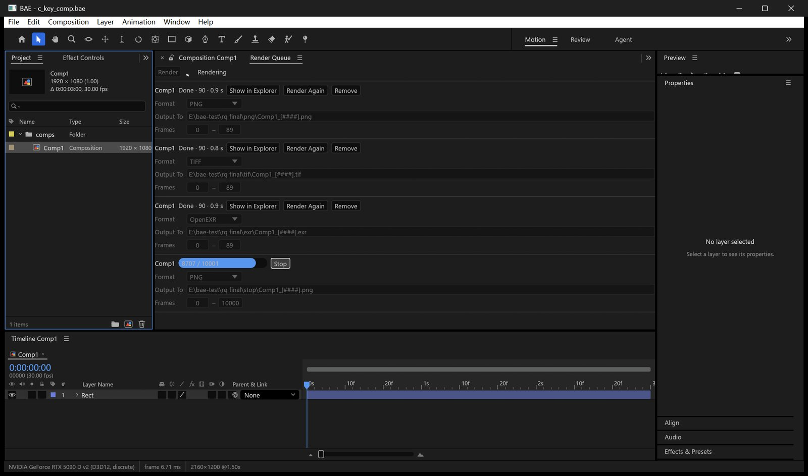
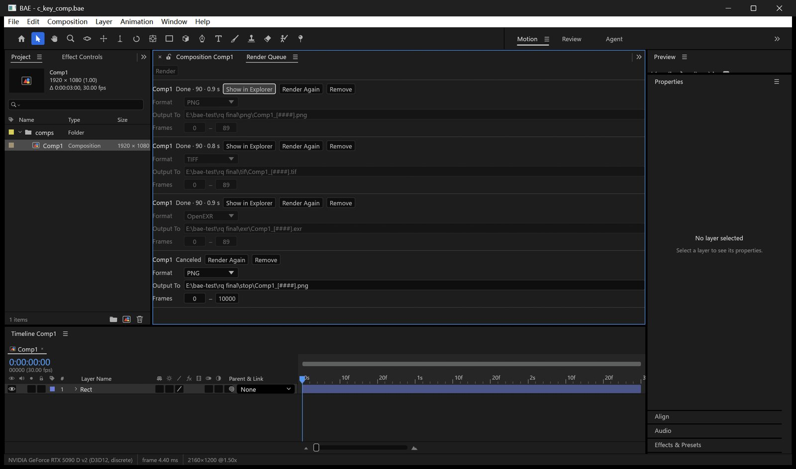
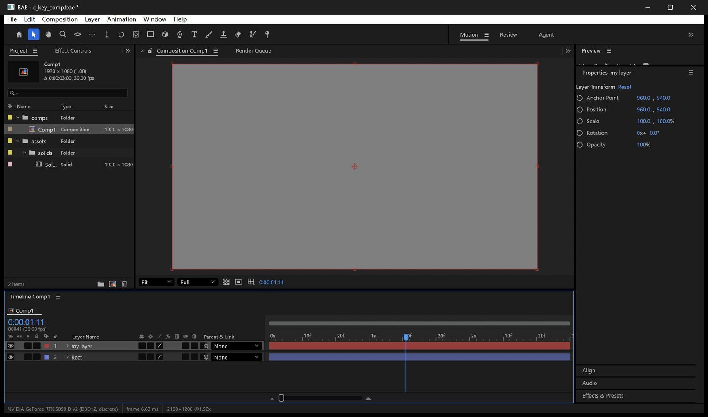

# Windows 实机：0.0.1 最终验收 — C 渲染队列与 #102 按键路由补测

- 日期：2026-11-21
- 机器：Windows 11 + **NVIDIA GeForce RTX 5090 D v2**（D3D12），20 逻辑核，2160×1200 @1.50x
- BAE：`origin/dev` @ **`293561a`**（`293561a9a8bd39f1b90245042c88196255b9bd39`，`Merge pull request #102 from FELIXDAD/ui/key-routing`）
- 构建：`target/release/bae.exe`（30,633,472 bytes，release 构建）
- 设置：**默认**（未设 `WGPU_DX12_COMPILER`）
- 操作与锁：持 `gui.lock` 实测（测毕释放）；全部窗口启动与按键输入通过 `orca computer`（`launch-app` / `get-app-state` / `press-key` / `hotkey` / `type-text`，`--restore-window`、`--screenshot-scale 1`）；按钮一律 `Tab` / `Shift+Tab` 聚焦后 `Enter` 或 `Space` 触发，不靠坐标点击按钮。
- 截图：[`c-keyboard-shots/`](./c-keyboard-shots/)（共 6 张，单张 90–117 KB，均 ≤ 400 KB）

## 总结表（C 渲染队列 @ `293561a`）

| 步骤 | 项目 | 结果 | 一句话结论 |
|---|---|---|---|
| 1 | 准备动画合成并在项目面板打开 | **通过** | `c_key_comp.bae`（1080p30 3 s / 90 帧 + Rect + 第 0/60 帧 Position 关键帧）经 `.bat` + `launch-app` 启动；项目面板选中 `Comp1` 后 `Enter` 进入重命名（AE 行为），`Esc` 后双击打开合成 |
| 2 | 添加到渲染队列（`Ctrl+M`） | **通过** | `Ctrl+M` 将 `Comp1` 入队并切到 `Render Queue` 面板，显示 `Queued` / `PNG` / Frames `0 – 89` |
| 3 | PNG（含空格路径 + `Tab` + `Enter`） | **通过** | 路径框键入 `E:\bae-test\rq final\png\Comp1_[####].png` 时空格正常输入且不播放；`Shift+Tab` 聚焦 `Render` 后 `Enter` 渲染完成（面板 **0.9 s** / 外测 1.26 s），产出 **90** 帧 PNG，首尾矩形中心从 `(399.5, 539.5)` 移至 `(1399.5, 539.5)` |
| 4 | 不压缩 TIFF（`Tab` + `Space`）与 OpenEXR（`Tab` + `Enter`） | **通过** | TIFF 用 `Tab + Space` 触发（不播放），产出 **90** 帧（**0.8 s**），每帧 **8,294,698 B**（`1920×1080×4 + 298 B` 不压缩）；EXR 用 `Tab + Enter` 触发，产出 **90** 帧（**0.9 s**，魔数 `76 2F 31 01`） |
| 5 | 渲染中途 `Tab` 到「停止」+ `Enter` | **通过** | 10,001 帧任务渲至 `8707 / 10001`（磁盘 8,886 帧、UI 帧耗时 6.71 ms 不卡）时 `Tab` 聚焦 `Stop` 按 `Enter` 立即中止，状态变为 `Canceled`，已写 8,886 个临时帧自动清零 |
| 6 | `Tab` 到「在资源管理器中显示」+ `Enter` | **失败** | 含空格路径（`E:\bae-test\rq final\png\Comp1_0000.png`）按 `Enter` 唤起 Explorer 但退回打开「文档」（`file:///D:/05_Documents/Documents`）；对照无空格路径（`E:\bae-test\rq_nospace`）正常打开目标目录；根因为 `render_queue.rs:506-507` 将 `/select,<path>` 拼为单参数被 Rust 整体加引号 |
| 7 | 图层改名输空格 + 离焦后空格播放 | **通过** | 时间轴重命名输入 `"my layer"` 时空格进名字不播放（CTI 保持 `0:00:00:00`）；`Enter` 提交或 `Esc` 离焦后按 `Space` 均正常播放（推进至 `0:00:01:26` / `0:00:01:11`） |

**整体判定**：#102 按键路由与渲染队列核心链路（PNG / 不压缩 TIFF / OpenEXR 实渲、`Tab+Enter` / `Tab+Space`、含空格路径输入、中途 `Stop`、图层带空格改名与离焦播放）在 Windows 5090 实机**全部通过**；仅步骤 6 检出 1 个 Windows 实机缺陷（`Show in Explorer` 遇到带空格路径时被参数引号破坏 `/select,` 开关，退回打开「文档」）。

---

## 逐步实测记录与证据

### 1. 准备动画合成并打开

- 复用 `E:\bae-test\acc\c_key_comp.bae`（通过 `bae.exe export-json` 核对）：
  - 合成 `Comp1`：1920×1080，30 fps，时长 3.0 s（`2116800000` ticks = 90 帧，工作区 0–89）。
  - 图层 `Rect`（形状图层，360×360 蓝色矩形）：`transform:position` 关键帧第 0 帧 `[400.0, 540.0, 0.0]`、第 60 帧（`1411200000` ticks）`[1400.0, 540.0, 0.0]`。
- 通过 `E:\bae-test\acc\launch_c_key.bat` 调用 `bae.exe E:\bae-test\acc\c_key_comp.bae`，由 `orca computer launch-app --activate` 启动，窗口标题为 `BAE - c_key_comp.bae`（2182×1286）。
- 在项目面板单击选中 `Comp1` 后按 `Enter`：按 AE 惯例触发行内重命名；按 `Esc` 取消后双击 `Comp1`，合成视口与时间轴正常打开，CTI 位于 `0:00:00:00`。

### 2. 添加到渲染队列（`Ctrl+M`）

- 按 `Ctrl+M`（`orca computer hotkey --key CmdOrCtrl+M`）：`Render Queue` 面板自动打开并获焦，列表出现 `Comp1 Queued`、`Format: PNG`、`Frames: 0 – 89`。

### 3. PNG 渲染（含空格路径 + `Tab` + `Enter`）

- 聚焦 `Output To` 文本框后 `Ctrl+A` 并用 `type-text` 逐字输入 `E:\bae-test\rq final\png\Comp1_[####].png`：
  - 空格正常落入文本框，时间轴 CTI 仍为 `0:00:00:00`（未触发播放）。
- 按 `Shift+Tab` ×3 将焦点移至 `Render` 按钮（见图 1），按 `Enter` 开始渲染：
  - 面板结果：`Comp1 Done · 90 · 0.9 s`（外测轮询至 90 文件完成耗时 `1.26 s`）。
  - 磁盘核对：`E:\bae-test\rq final\png\` 共 **90** 个 PNG（`Comp1_0000.png`–`Comp1_0089.png`，每帧 42,801 B，1920×1080 RGBA）。
  - 动画位置核对（像素检测 360×360 = 129,600 个蓝色像素的包围盒与中心）：
    - `Comp1_0000.png`：bbox `(220, 360)..(579, 719)`，中心 **`(399.5, 539.5)`**
    - `Comp1_0030.png`：bbox `(720, 360)..(1079, 719)`，中心 **`(899.5, 539.5)`**
    - `Comp1_0060.png`：bbox `(1220, 360)..(1579, 719)`，中心 **`(1399.5, 539.5)`**
    - `Comp1_0089.png`：bbox `(1220, 360)..(1579, 719)`，中心 **`(1399.5, 539.5)`**



### 4. 不压缩 TIFF（`Tab + Space`）与 OpenEXR（`Tab + Enter`）

- **不压缩 TIFF**（`Tab + Space` 触发）：
  - `Ctrl+M` 新增第 2 项；`Shift+Tab` 聚焦 `Format` 下拉框后按 `Space` 展开（不触发播放）并选 `TIFF`（扩展名自动变为 `.tif`）；在 `Output To` 键入 `E:\bae-test\rq final\tif\Comp1_[####].tif`。
  - `Shift+Tab` ×6 聚焦 `Render` 按钮（见图 2），按 **`Space`** 触发渲染（时间轴 CTI 仍为 `0:00:00:00`，未误播）。
  - 面板结果：`Comp1 Done · 90 · 0.8 s`（外测 1.20 s）。
  - 磁盘核对：`E:\bae-test\rq final\tif\` 共 **90** 个 `.tif`，单帧大小 `min = max = avg = 8,294,698 B`（`1920 × 1080 × 4 = 8,294,400 B` + 298 B TIFF 头，确认为不压缩 RGBA TIFF）。
- **OpenEXR**（`Tab + Enter` 触发）：
  - `Ctrl+M` 新增第 3 项，格式选 `OpenEXR`，路径键入 `E:\bae-test\rq final\exr\Comp1_[####].exr`。
  - `Shift+Tab` ×9 聚焦 `Render` 按钮，按 `Enter` 触发渲染。
  - 面板结果：`Comp1 Done · 90 · 0.9 s`（外测 1.29 s）。
  - 磁盘核对：`E:\bae-test\rq final\exr\` 共 **90** 个 `.exr`，单帧 29,326–33,191 B，首文件头魔数 `76 2F 31 01`（合法 OpenEXR）。





### 5. 渲染中途 `Tab` 到「停止」+ `Enter`

- 因为 90 帧在本机 RTX 5090 上仅需 ~0.9 s（先前试跑 3,001 帧亦仅用 7.5 s ≈ 400 fps），为制造充足的中途交互窗口，第 4 条队列设为 `E:\bae-test\rq final\stop\Comp1_[####].png`、帧范围 `0 – 10000`（10,001 帧）。
- `Tab + Enter` 启动后，在渲染进行中进度显示 `8707 / 10001`、界面帧耗时 `6.71 ms`（完全不卡顿）时，通过 `Tab` 聚焦 `Stop` 按钮（见图 4；此时磁盘已写入 8,886 个 PNG），随后按 `Enter`：
  - 渲染立刻停止，状态更新为 **`Canceled`**（并出现 `Render Again` / `Remove` 按钮，界面帧耗时 `5.20 ms`）；
  - 1.2 s 与 2.7 s 两次检查 `E:\bae-test\rq final\stop\` 文件数均为 **0**（符合 `render_queue.rs` 对中止时清理未完成输出的设计）。
- **附注观察**：本次操作中为进入 Tab 链先聚焦了左侧 `Project` 搜索框（导致停靠焦点留在 `Project` 面板且 `Comp1` 处于选中态），随后 Tab 移到 `Render Queue` 的 `Stop` 按钮按 `Enter` 时，既停止了渲染，也同时触发了 `Project` 面板的 `Enter` 行内重命名（`crates/bae-ui-motion/src/project.rs:455` 直接读取 `ui.input(|i| i.key_pressed(Key::Enter))` 而未排除已有其它按钮获焦的情形）。



### 6. `Tab` 到「在资源管理器中显示」+ `Enter`（失败）

- 切回 `Render Queue` 面板焦点，通过 `Shift+Tab` 聚焦第 1 条已完成项（`E:\bae-test\rq final\png\Comp1_[####].png`）的 `Show in Explorer` 按钮（见图 5）。
- 由于本机 agent 命令行处于隔离桌面，Win32 `EnumWindows` 无法跨桌面看到用户桌面的 `CabinetWClass` 窗口，改用 `Shell.Application` COM 接口（枚举真实用户桌面上的全部 Explorer 窗口）做前后比对：
  - **按 `Enter` 前**：2 个既有窗口（`0x80916 此电脑`、`0x609A4 自动驾驶：前夜`）。
  - **对含空格路径 `E:\bae-test\rq final\png\Comp1_0000.png` 按 `Enter` 后**：新增窗口 `HWND=0x601658`，但位置为 **`file:///D:/05_Documents/Documents`（`文档`）**，未打开 `E:\bae-test\rq final\png`。
- **无空格路径对照验证**：同一会话中将第 4 条队列改到 `E:\bae-test\rq_nospace\Comp1_[####].png`（帧 `0 – 1`）渲出 2 个 PNG，再 `Tab` 聚焦其 `Show in Explorer` 按 `Enter`：
  - `Shell.Application` 检出新增窗口 `HWND=0x579100C`，位置精确为 **`file:///E:/bae-test/rq_nospace`（`rq_nospace`）**。
- **只读源码根因确认**：`crates/bae-ui-motion/src/render_queue.rs:505-508`：
  ```rust
  #[cfg(windows)]
  let result = std::process::Command::new("explorer")
      .arg(format!("/select,{}", path.display()))
      .spawn();
  ```
  当 `path` 包含空格时，Rust 标准库在 Windows 命令行转义时会把单个参数整体包裹双引号，实际传给 `explorer.exe` 的命令行变为 `"/select,E:\bae-test\rq final\png\Comp1_0000.png"`。Windows `explorer.exe` 不识别带外层引号的 `/select,` 开关，遂静默回退到用户「文档」目录（改为 `.arg("/select,").arg(path)` 或 `raw_arg` 即可修复）。



### 7. 图层改名输入空格 + 离焦后空格仍可播放

- 在时间轴双击图层 `Rect` 名称进入行内重命名文本框（注：选中后直接按 `Enter` 不会在时间轴开启改名，双击才会），`Ctrl+A` 后用 `type-text` 逐字输入 `"my layer"`：
  - 文本框内完整显示 `my layer`，等待 600 ms 时间轴 CTI 保持 `0:00:00:00`（未触发播放）。
  - 按 `Enter` 提交后窗口标题变为 `BAE - c_key_comp.bae *` 且焦点离开文本框；按 `Space` 播放正常启动，CTI 推进至 `0:00:01:26`（帧 56，Position `1333.3, 540.0`），再按 `Space` 停在 `0:00:02:14`（帧 74）。
  - *附注*：`c_key_comp.bae` 的 `layer_stack` 为 `["agent/c-key", "root"]`，更强的 `agent/c-key` 子层遮蔽了 GUI 写入 `root` 的新名称，因此界面上该图层名仍显示 `Rect`。
- 为同时验证改名落盘显示与 **`Esc` 离焦后播放**：在同合成中 `Ctrl+Y` 新建 `root` 层固态图层，双击改名为 `"my layer"` 并 `Enter` 提交 → 时间轴与属性面板均显示 **`my layer`**，CTI 仍 `0:00:00:00`；再次双击进入改名追加 `" test"` 后按 **`Esc`** 取消离焦，随后按 `Space` 确认播放正常推进至 **`0:00:01:11`**（帧 41，见图 6）。


