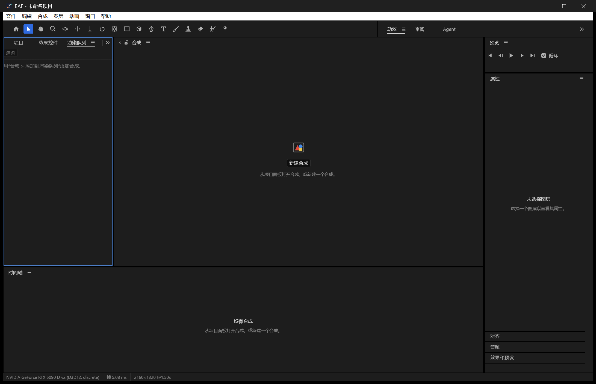
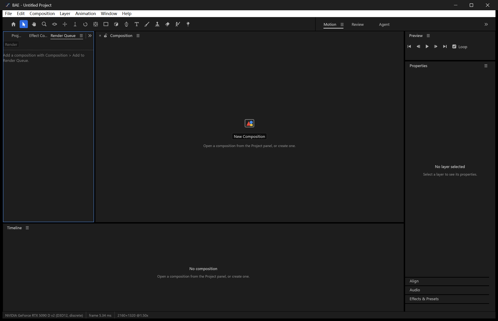
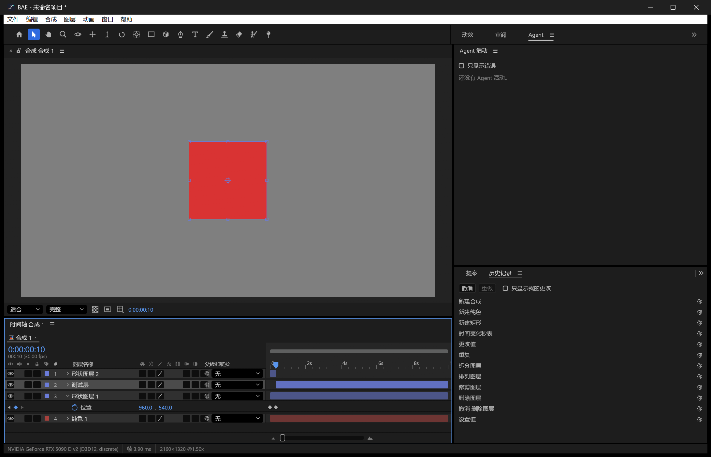
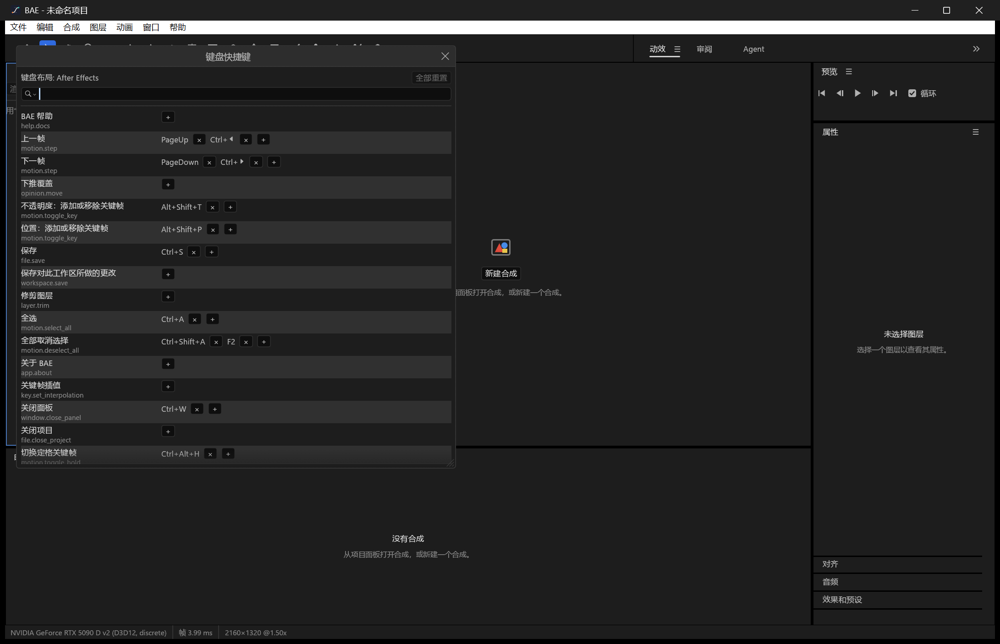

# Windows 实机复测：缺字、中文命令名与快捷键唯一性（#135、#136、#140 / PR #138）

- 日期：2026-11-21
- 机器：Windows 11 + **NVIDIA GeForce RTX 5090 D v2**（D3D12），主显示器 3840×2160，**150% DPI**（`AppliedDPI = 144`）
- BAE：`origin/dev` @ **`d95480a`**（`d95480ab99b7340dbcae6de6bf4ba75f0aab183b`，`Merge pull request #138 from FELIXDAD/ui/glyphs-and-i18n`）
- 构建：`cargo build --release -p bae` → `target/release/bae.exe`（31,346,176 bytes）
- 设置：**默认设置**（清空 `%LOCALAPPDATA%\BAE\State\{window,workspaces}.json` 后冷启动，`2160×1320 @1.50x`，窗口 `2182×1406`）
- 启动与操作：按隔离桌面流程通过 `.bat`（`set BAE_LANG=zh` / `en`）+ `orca computer launch-app --activate` 启动；全程持 `E:\bae-test\locks\gui.lock`（测毕已关闭 BAE 并释放锁）；共导出 **47 份**完整 UIA 树（`en` 3 份、`zh` 44 份，`truncated: false`），用 Python 脚本全量扫描字形、中文译名残留与快捷键唯一性。
- 截图：[`i18n-retest-shots/`](./i18n-retest-shots/)（共 4 张，均为 BAE 窗口，单张 90–165 KB）

## 复测结论总表（`dev` @ `d95480a`）

| Issue | 复测项 | 语言 / 缩放 | Windows 结论 | 关键验证结果 |
|---|---|---|---|---|
| **#135** | 渲染队列空状态与全界面缺字检查 | `zh` + `en` / 150% | **通过** | 渲染队列空状态改为 `>`，中英文均无缺字方块 `□`；47 份 UIA 树全量 Unicode 扫描检出 **0** 个 `□`/`U+FFFD`/`▸`，快捷键方向三角 `⏴`/`⏵` 目视渲染清晰 |
| **#136** | 中文命令名、撤消/重做、历史记录与面板标题 | `zh` / 150% | **通过**（附非命令类轻微残留观察） | 实操新建合成/纯色/矩形/关键帧/改值/复制/拆分/排列/修剪/删除/撤消/改名后，`编辑 ▸ 撤消/重做`、`历史记录`（12 条）、`键盘快捷键` 全部 129 条主标题及全部菜单/面板标题均无未翻译英文命令名或原始面板 ID（原报 14 个命令 + 3 个面板 ID 全已修复） |
| **#140** | 快捷键列表每行名称唯一、无内部 ID | `zh` + `en` / 150% | **通过** | 导出全部 **129 行**（`elementCount: 661`，未截断），脚本扫描重复数为 **0**（中英均为 0），内部 ID 充当主标题为 **0**；`motion.step` / `motion.order` / `motion.toggle_key` / `motion.reveal` / `motion.new_layer` / `motion.ease` 与 5 个缩放动作均各自命名清晰 |

> macOS 侧已在 `d95480a` 上确认通过并关闭 #135、#136、#140；Windows 侧已在三个 issue 下补充实机复测通过评论与本报告链接。

---

## 逐项实测记录与扫描结果

### 1. #135：缺字复测（`BAE_LANG=zh` & `en`，150% DPI）

1. **渲染队列空状态（`Ctrl+Alt+0`）**：
   - `BAE_LANG=zh`：UIA 节点 `54 文本 用“合成 > 添加到渲染队列”添加合成。`，截图确认 `>` 渲染清晰，无缺字方块 `□`。
   - `BAE_LANG=en`：UIA 节点 `54 文本 Add a composition with Composition > Add to Render Queue.`，截图确认 `>` 渲染清晰，无缺字方块 `□`。
2. **主要界面全量扫描与目视检查**：
   - 覆盖界面：欢迎框、全部 7 个顶部菜单与 4 个子菜单、动效 / 审阅 / Agent 三个工作区、空与非空渲染队列、项目、合成、时间轴（含展开关键帧）、预览、属性、效果控件、对齐、音频、效果和预设、信息、历史记录、Agent 活动、提案、键盘快捷键、关于 BAE、编辑工作区对话框。
   - Python 全量扫描 47 份 UIA 树结果：
     - `□`（`U+25A1`）、``（`U+FFFD`）、`▸`（`U+25B8`）：**0 处**。
     - 检出的非 ASCII / 非 CJK 符号仅 4 个：`⏴`（`U+23F4`）、`⏵`（`U+23F5`，快捷键列表 `Ctrl+⏴` / `Ctrl+⏵`）与 `⏶`（`U+23F6`）、`⏷`（`U+23F7`，编辑工作区排序按钮）；截图确认快捷键对话框中 `⏴`/`⏵` 渲染为清晰三角形，无方块。

---

### 2. #136：中文命令名、菜单、历史记录与全量 UIA 扫描（`BAE_LANG=zh`）

1. **连续实操验证**：
   - 在 `BAE_LANG=zh` 下依次执行：`Ctrl+N`（新建合成）→ `Ctrl+Y`（新建纯色）→ `图层 ▸ 新建 ▸ 矩形`（新建矩形）→ `Alt+Shift+P`（时间变化秒表/位置关键帧）→ `Shift+PageDown` + `Alt+Shift+P`（更改值/第 2 帧关键帧）→ `F9`（缓动）→ `Ctrl+D`（重复）→ `Ctrl+Shift+D`（拆分图层）→ `Ctrl+[`（排列图层）→ `Alt+[`（修剪图层）→ `Delete`（删除图层）→ `Ctrl+Z`（撤消）→ 双击重命名图层为 `测试层`（设置值）。
2. **`编辑 ▸ 撤消 / 重做` 菜单项（UIA 实测）**：
   - 删除后撤消一次时：`11 菜单项 撤消 修剪图层`、`12 菜单项 重做 删除图层`（不再出现 `撤消 New Layer` 这类中英混排）。
   - 重命名图层后：`11 菜单项 撤消 设置值`、`12 菜单项 (disabled) 重做`。
3. **`历史记录` 面板（`Agent` 与 `审阅` 工作区，UIA 实测共 12 条，全中文）**：
   - `新建合成`、`新建纯色`、`新建矩形`、`时间变化秒表`、`更改值`、`重复`、`拆分图层`、`排列图层`、`修剪图层`、`删除图层`、`撤消 删除图层`、`设置值`（作者列均为 `你`）。
4. **`键盘快捷键` 对话框（129 行全量扫描）**：
   - 原 #136 报告的 14 个英文命令名已全部译为中文（`接受提案`、`更改值`、`更改多个值`、`删除关键帧`、`删除图层`、`移动关键帧`、`在时间上移动图层`、`新建图层`、`粘贴关键帧`、`拒绝提案`、`排列图层`、`设置父级`、`设置工作区域`、`修剪图层`）。
   - 原 #136 报告的 3 个原始面板 ID 已全部译为中文：`打开面板: 字符`（`Ctrl+6`）、`打开面板: 段落`（`Ctrl+7`）、`打开面板: 工具`（`Ctrl+1`）。
   - 129 条主标题中含 ASCII 字母的仅 3 条，全部为专有名词：`BAE 帮助`、`关于 BAE`、`切换工作区: Agent`。
5. **顶部菜单与面板标题**：
   - 全部 7 个顶部菜单（`文件`、`编辑`、`合成`、`图层`、`动画`、`窗口`、`帮助`）及子菜单（`新建`、`排列`、`关键帧辅助`、`工作区`）、全部 14 个面板标题（`项目`、`效果控件`、`渲染队列`、`信息`、`合成`、`时间轴`、`预览`、`属性`、`对齐`、`音频`、`效果和预设`、`Agent 活动`、`提案`、`历史记录`）均已中文化（除专有名词 `Agent`/`BAE`）。
6. **44 份 `zh` UIA 树全量英文单词扫描清单**：
   - **可忽略的专有名词 / 缩写 / 单位 / 硬件 / 快捷键 / 路径**：
     - 产品与工作区名：`BAE`、`After Effects`、`Agent`、`Roto`（`Roto 笔刷工具`）、`Apache-2.0`
     - 单位、格式、坐标与硬件信息：`GPU`、`3D`、`X`、`Y`、`ms`、`0x+`、`PNG`、`2160×1320 @1.50x`、`NVIDIA GeForce RTX 5090 D v2 (D3D12, discrete)`、`BAE 0.1.0 (x86_64-windows, release)`、输出路径 `C:\Users\king\Movies\合成 2\合成 2_[####].png`
     - 快捷键按键名（`Ctrl+Z`、`Alt+Shift+P`、`PageUp`、`Space` 等）与快捷键列表次行命令 ID（`motion.step` 等）
   - **扫描发现的非命令类轻微英文残留（均不在 #136 原列命令/面板标题范围内，记录备后续清理）**：
     1. 快捷键列表 5 行小号命令 ID 副标题的作用域后缀：`viewer.zoom_in · composition`、`viewer.zoom_out · composition`、`viewer.fit · composition`、`timeline.zoom_in · timeline`、`timeline.zoom_out · timeline`（`crates/bae-ui/src/workbench/shortcuts.rs` 对小写面板 ID 直接调了 `tr(p)`，未先查面板标题；主标题已全中文）。
     2. egui 浮动窗口关闭按钮的 AccessKit 无障碍名称：`按钮 Close window`（`键盘快捷键`、`关于 BAE`、`编辑工作区` 右上角 `×`，屏幕仅绘制 `×`，UIA 暴露为 egui 默认英文名）。
     3. 项目面板内置根文件夹节点名：`comps`、`assets`、`solids`。
     4. 形状图层默认子内容名称：`Rectangle Path 1`、`Fill 1`（新建矩形后属性面板显示 `Rectangle Path 1 · 大小`、`Fill 1 · 颜色`）。
     5. 状态栏硬件信息括号内英文词：`discrete`（`NVIDIA GeForce RTX 5090 D v2 (D3D12, discrete)`）。

---

### 3. #140：快捷键对话框列表名称唯一性（`zh` & `en`，150% DPI）

在 `BAE_LANG=zh` 和 `BAE_LANG=en` 下分别按 `Ctrl+Alt+'` 打开 `键盘快捷键` 对话框，使用 `orca computer get-app-state --app bae --max-elements 10000 --json` 导出完整 UIA 树（`elementCount: 661`，`truncated: false`），用脚本逐行解析全部 **129 条**命令记录：

| 指标 | 中文（`BAE_LANG=zh`） | 英文（`BAE_LANG=en`） |
|---|---|---|
| 命令总行数 | **129** | **129** |
| 重复标题数 | **0** | **0** |
| 内部 ID 当主标题数 | **0** | **0** |

重点参数变体与原无标题命令核对结果（全部唯一且语义准确）：

- **`motion.step`（4 行）**：`上一帧` / `Previous Frame`（`PageUp`, `Ctrl+⏴`）、`下一帧` / `Next Frame`（`PageDown`, `Ctrl+⏵`）、`后退 10 帧` / `Back 10 Frames`（`Shift+PageUp`）、`前进 10 帧` / `Forward 10 Frames`（`Shift+PageDown`）
- **`motion.order`（4 行）**：`前移一层` / `Bring Layer Forward`（`Ctrl+]`）、`后移一层` / `Send Layer Backward`（`Ctrl+[`）、`置于顶层` / `Bring Layer to Front`（`Ctrl+Shift+]`）、`置于底层` / `Send Layer to Back`（`Ctrl+Shift+[`）
- **`motion.toggle_key`（5 行）**：`锚点 / 位置 / 缩放 / 旋转 / 不透明度：添加或移除关键帧`（英文 `Anchor Point / Position / Scale / Rotation / Opacity: Add or Remove Keyframe`，对应 `Alt+Shift+A/P/S/R/T`）
- **`motion.reveal`（11 行）**：6 条 `显示…`（`A/P/S/R/T/U`）+ 5 条 `将…添加到显示的属性`（`Shift+A/P/S/R/T`）
- **`motion.new_layer`（9 行）**：`新建纯色`、`新建调整图层`、`新建空对象`、`新建文本图层`、`新建摄像机`、`新建灯光`、`新建形状图层`、`新建矩形`、`新建椭圆`
- **`motion.ease`（3 行）**：`缓动`（`F9`）、`缓入`（`Shift+F9`）、`缓出`（`Ctrl+Shift+F9`）
- **原只显示内部 ID 的 5 条缩放命令**：`timeline.zoom_in` → `放大时间` / `Zoom In Time`、`timeline.zoom_out` → `缩小时间` / `Zoom Out Time`、`viewer.fit` → `适合` / `Fit`、`viewer.zoom_in` → `放大` / `Zoom In`、`viewer.zoom_out` → `缩小` / `Zoom Out`

