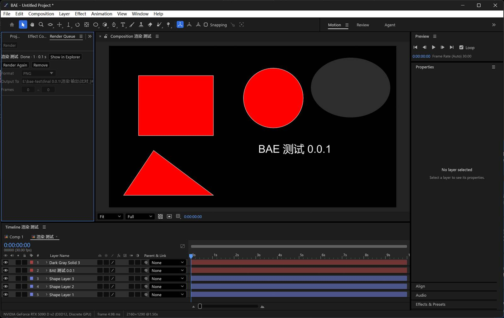
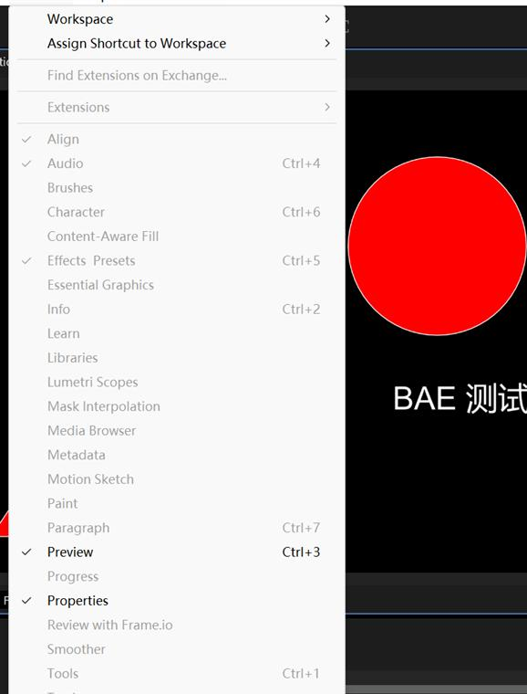
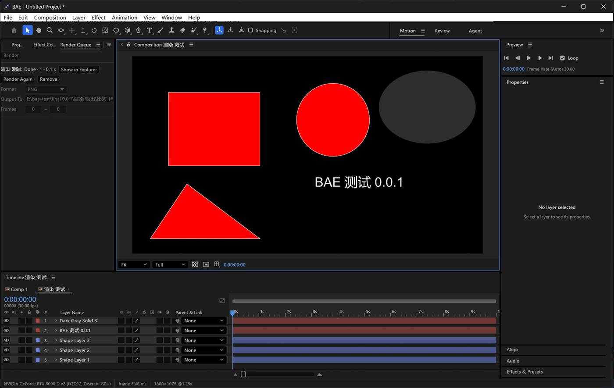
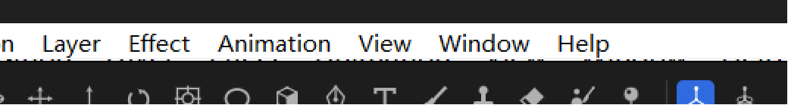

# 0.0.1 最终回归 · Windows（缩减版 C）

- 日期：2026-11-22
- 执行：米兰 Mac 上的 Claude 远程操作 5090（只测试，不改代码）
- 范围：只测 Windows 特有的风险；共用的界面逻辑以 macOS 回归为准

## 结论

- **没有发现 0.0.1-blocker。** 发布包在带空格和中文的路径下能启动、新建、保存、另存为、重新打开、渲染、退出提示都正常。
- 新开的 issue（都是 `bug`，不阻塞发布）：
  - #215 关闭项目后，合成和时间轴面板标签仍显示旧合成名（共用代码，macOS 上应该也有）
  - #216 Windows：渲染队列默认输出目录优先用 `%USERPROFILE%\Movies`，忽略被移动过的“视频”已知文件夹
  - #217 Windows 发布包：README 没写 SmartScreen“仍要运行”的放行步骤；`bae.exe` 没有版本资源
  - #220 Windows：Ctrl+Shift+C（预合成）、Ctrl+Alt+Shift+C（新建摄像机）等“Ctrl+修饰键+C/X/V”快捷键无效，被当成复制/剪切/粘贴
  - #222 输入框里 Ctrl+Z 会恢复出输入法组字的中间文本（小问题）
  - #226 Windows：菜单文字里的 & 被当成助记符吞掉（“Effects & Presets”显示成“Effects  Presets”，共 8 项）
  - #227 Windows：运行中把系统缩放从 150% 改小后，原生菜单栏下方留下一行旧文字残影（小问题）
- 建议：第 1–4 批的结果支持发布。总协调已定：#215、#216 发布前修；#217 的放行步骤写进发布说明和 README，版本资源排到 0.0.1 之后。#220 影响常用的 AE 快捷键（预合成），菜单仍可用，建议发布前修。
- 后续批次的结论见下面各节（做完一批更新一次）。

## 环境

| 项 | 值 |
|---|---|
| dev 提交 | `160fab5b6f07f306b4983571549198a4bf496057`（Merge PR #98 release/0.0.1） |
| 被测包 | CI run 44995382166，artifact `bae-x86_64-pc-windows-msvc` |
| zip | `BAE-0.0.1-x86_64-windows.zip`，12,729,147 字节，SHA256 `FB8A697FFFA207913C8BEC21F3FC9EEC6418EE8E2A258C04016C749C453433F0` |
| exe | `bae.exe` 32,380,928 字节（30.88 MiB，预算 32 MiB，`size-report.json` pass）；`bae.exe --version` = `bae 0.0.1 (x86_64-windows, release)` |
| Windows | Windows 11 专业版 25H2，10.0.26200 |
| 显卡 | NVIDIA GeForce RTX 5090 D v2，驱动 32.0.16.1692；BAE 状态栏：`NVIDIA GeForce RTX 5090 D v2 (D3D12, Discrete GPU)` |
| 显示 | 主屏 3840×2160，150%（BAE 状态栏 `2160×1320 @1.50x`） |
| 输入法 | 只装了中文（简体）· 微软拼音（Preload = 00000804） |

### 操作方式

米兰到 5090 的 Orca 配对没有 `desktop-control` 权限，`orca computer …` 全部返回 forbidden。所以界面操作全部改在 5090 的终端里用 PowerShell 做：

- 控件：`System.Windows.Automation`（BAE 的 accesskit 树，88 个左右的元素）；
- 菜单：BAE 的菜单栏是原生 Win32 菜单，用 `GetMenu` 枚举（646 项）后 `WM_COMMAND` 调用；
- 键鼠：`keybd_event` / `SetCursorPos` + `mouse_event`，每次输入前检查前台窗口必须是 bae.exe；
- 文字：剪贴板粘贴（避开微软拼音的组字）；
- 原生文件对话框：置前后 Alt+N、粘贴路径、回车。

## 自动化结果

规划者的后台脚本在 5090 上对 `160fab5` 源码跑（日志 `E:\bae-test\final-0.0.1\logs\`），没有设置 `WGPU_DX12_COMPILER`：

| 项 | 结果 |
|---|---|
| `cargo test -p bae` | 退出 0；2 个测试集，54 passed / 0 failed |
| `cargo test --workspace`（默认适配器，RTX 5090 DX12） | 退出 0；117 个测试集，1059 passed / 0 failed / 6 ignored |
| `cargo test --workspace`（`BAE_GPU_ADAPTER=software`，WARP） | 退出 0；117 个测试集，1059 passed / 0 failed / 6 ignored |
| `bae-render --test render` 在 WARP 下循环 50 次 | 0 次 0xC0000005，0 次其他失败 |
| `bae-text --test cpu` 在 WARP 下循环 50 次 | 0 次 0xC0000005，0 次其他失败 |

## 第 1 批：发布包首次运行

zip 复制到 `E:\bae-test\final 0.0.1\发布 包\`，加 Zone.Identifier（`[ZoneTransfer] ZoneId=3`），用 `Shell.Application` 的 `CopyHere` 解压到 `…\发布 包\BAE\`。解压出的 `bae.exe`、`LICENSE`、`README.md` 都带上了 `ZoneId=3`。

| 用例 | 结果 | 说明 |
|---|---|---|
| 来自网络的 exe 首次启动 | 通过（有提示，见 #217） | `Start-Process`（ShellExecute）和资源管理器打开都弹 SmartScreen“Windows 已保护你的电脑”，只有“不运行”；“更多信息”里是“应用：bae.exe / 发行者：发布者未知”；点“仍要运行”后 3 秒内出现主窗口。README 没写这一步 → #217 |
| 从带空格和中文的路径启动 | 通过 | `E:\bae-test\final 0.0.1\发布 包\BAE\bae.exe`，欢迎框 ▸ Motion 正常进入 |
| 关于里是 0.0.1 | 通过 | 帮助 ▸ 关于 BAE：`BAE 0.0.1 (x86_64-windows, release)`、`License: Apache-2.0` |
| exe 版本资源 | 未通过 #217 | `VersionInfo.FileVersion/ProductVersion` 都是空的 |
| 新建合成 | 通过 | Ctrl+N 打开合成设置，名字改成“合成 测试”，确定后项目里出现合成，标题栏加 `*`；Ctrl+Y 加纯色层正常 |
| 保存为 .bae（中文路径） | 通过 | Ctrl+S 弹原生“Save As”对话框（主窗口被禁用），存到 `E:\bae-test\final 0.0.1\工程 测试\回归 工程.bae`：生成目录，里面有 `project.json`、`sublayers\root.loro`；标题栏变成 `BAE - 回归 工程.bae` |
| 另存为 .baez | 通过 | 按已知情况 Ctrl+Shift+S 被系统热键占用，走菜单 文件 ▸ 另存为 ▸ 另存为…；存成 `回归 打包.baez`（3,412 字节 zip，内含 `project.json`、`sublayers/root.loro`），标题栏更新 |
| 重新打开 .bae | 通过 | 关闭项目后 Ctrl+O；对话框过滤器是 `BAE Project (.baez, project.json)`，输入 `.bae` 路径会进入目录，选里面的 `project.json` 打开；合成、纯色层、`comps`/`solids` 文件夹都在 |
| 重新打开 .baez | 通过 | Ctrl+O 选 `.baez`，内容完整 |
| 关闭项目后的界面 | 未通过 #215 | 面板标签仍是“Composition 合成 测试”“Timeline 合成 测试”（显示残留，无数据问题） |
| 渲染队列输出 PNG 到中文路径 | 通过 | Ctrl+M 加入渲染队列；输出改成 `E:\bae-test\final 0.0.1\渲染 输出\帧_[####].png`，帧 0–4；状态 `Done · 5`；生成 `帧_0000.png`…`帧_0004.png`，1920×1080，中心像素 (45,45,45) 与深灰纯色一致 |
| 渲染队列默认输出目录 | 未通过 #216 | 默认是 `C:\Users\<用户>\Movies\合成 测试\…`；这台机器“视频”已知文件夹在 D 盘 |
| 有未保存修改时退出 | 通过 | 改动后 Ctrl+Q 弹原生对话框“Save changes to “回归 打包.baez” before closing?”（是 / 否 / 取消）；“取消”留在应用、`*` 还在；点窗口关闭（WM_CLOSE）再次提示，“否”后进程退出，磁盘上的 .baez 没变 |

## 第 2 批：键盘

期望以 `docs/ui/ae-commands.md`（AE 26 Windows 默认快捷键）和 `docs/ui/motion-parity.md` 为准。没有文字输入框有焦点时按键，结果用 UIA（对话框、图层、工具单选按钮的选中状态）和原生菜单“编辑 ▸ 撤消 <命令名>”判断。

先排除环境：用 `RegisterHotKey` 探测，这台机器上被其他程序注册成全局热键的有 **Ctrl+Shift+S、Alt+Shift+R、Ctrl+Alt+Y、Ctrl+Alt+M、Ctrl+Shift+A**，这些组合在本机测不了，不算 BAE 的问题。

| 用例 | 结果 | 说明 |
|---|---|---|
| Ctrl+N | 通过 | 打开“Composition Settings”，Enter 确定后建合成 |
| Ctrl+K | 通过 | 打开当前合成的合成设置，Esc 关闭 |
| Ctrl+Y | 通过 | 打开“Solid Settings”，Enter 后新建纯色层；撤消项是“Undo New Solid” |
| Ctrl+Shift+Y | 通过 | 选中纯色层时打开“Solid Settings” |
| Ctrl+Shift+C | 未通过 #220 | 没有预合成对话框（菜单 图层 ▸ 预合成… 可用，点菜单能打开）。原因：egui-winit 把“Ctrl + 任意修饰键 + C/X/V”转成复制/剪切/粘贴事件，BAE 当成 编辑 ▸ 复制。macOS 由原生菜单先处理，只有 Windows 受影响 |
| Ctrl+Alt+Shift+C | 未通过 #220 | 不出摄像机设置；对照 Ctrl+Alt+Shift+L 正常打开“Light Settings” |
| Ctrl+I | 通过 | 弹原生“Import File”对话框，Esc 取消 |
| Ctrl+M | 通过 | 渲染队列新增“Render Item 1 “Comp 1”” |
| Ctrl+Z / Ctrl+Shift+Z | 通过 | 新建第二个纯色层后 Ctrl+Z 少一层、Ctrl+Shift+Z 恢复 |
| V W H Z Y | 通过 | 选择、旋转、抓手、缩放、向后平移（锚点）工具 |
| Q 重复 | 通过 | 矩形 → 圆角矩形 → 椭圆 → 多边形 → 星形 → 矩形 |
| G 重复 | 通过 | 钢笔 → 蒙版羽化 → 钢笔（和 AE 一样只在这两个之间循环） |
| Ctrl+T 重复 | 通过 | 横排文字 ↔ 直排文字 |
| T | 通过 | AE 里 T 是“只显示不透明度”，不是文字工具：选中图层按 T，时间轴只显示 Opacity 100%（P 显示 Position） |
| Alt+[ / Alt+] | 通过 | 时间指示器移到第 10 帧 / 倒数第 10 帧后修剪入点 / 出点，撤消项“Undo Trim Layer” |
| Ctrl+Alt+Shift+L | 通过 | 新建灯光对话框 |
| Alt+Shift+P，只装微软拼音 | 通过 | 第 15 帧，打开位置秒表并加关键帧（撤消项“Undo Time-Vary Stopwatch”），输入法没被切换 |
| Alt+Shift+P，英文（美国）键盘 | 通过 | 用 `LoadKeyboardLayout("00000409")` + `WM_INPUTLANGCHANGEREQUEST` 把 BAE 切到英文布局，第 25 帧按下，加关键帧（“Undo Change Value”），布局仍是 0409 |
| Alt+Shift+P，两种布局都在、当前是微软拼音 | 通过 | 这是 Alt+Shift 切换输入法热键生效的场景；第 40 帧按下照样加关键帧，布局仍是 0804。测完卸载英文布局，`HKCU:\Keyboard Layout\Preload` 没变（仍只有 00000804） |
| 工具快捷键在微软拼音（中文模式）下 | 通过 | 上面的单键工具快捷键都是在 HKL 0804 下按的，没有被输入法吃掉 |
| 文本框有焦点时不抢键 | 通过 | 项目面板搜索框获得焦点后打 w q g t：工具保持“选择工具”；输入法组字显示 `w'q'g't`，Enter 上屏 `wqgt`；框里 Ctrl+Z 只撤销文字，不触发全局撤销 |
| 文本框里的撤销 | 未通过 #222（小） | 框里 Ctrl+Z 恢复出组字中间态 `w'q'g't`，这段文字从来没上屏过 |

## 第 3 批：渲染（DX12 真显卡）

BAE 状态栏：`NVIDIA GeForce RTX 5090 D v2 (D3D12, Discrete GPU)`，每帧 3.4–5.5 ms。新建 1920×1080 合成“渲染 测试”，查看器“适合”大小。GPU 压力测试由后台脚本负责（见“自动化结果”）。

| 用例 | 结果 | 说明 |
|---|---|---|
| 查看器画面 | 通过 | 黑色合成背景、图层、文字都正常显示，没有闪烁或花屏 |
| 矩形工具拖拽 | 通过 | 没选图层时拖出“Shape Layer 1”（撤消项“Undo Add Shape”），红色填充 |
| 椭圆工具拖拽（Q 循环到椭圆） | 通过 | F2 取消选择后拖出“Shape Layer 2”，正圆 |
| 钢笔工具 | 通过 | 点三个点再点回起点闭合，生成“Shape Layer 3”三角形（“Undo Edit Path”） |
| 文字工具拖拽 | 通过 | Ctrl+T 拖出段落文字框，粘贴“BAE 测试 0.0.1”，Esc 提交；中文字形正确（“Undo New Text”） |
| 蒙版 | 通过 | 新建纯色层（铺满）后选中它用椭圆工具拖拽，得到“Undo New Mask”；查看器里纯色只在椭圆内可见 |
| 渲染队列输出和查看器一致 | 通过 | 第 0 帧输出到 `E:\bae-test\final 0.0.1\渲染 输出\比对_0000.png`（1920×1080，`Done · 1 · 0.1 s`）。7 个采样点（矩形、圆、三角形内部，蒙版内 / 外，背景，矩形外边缘）查看器屏幕像素和 PNG 像素 RGB 完全相同：红 (255,0,0)、深灰 (45,45,45)、黑 (0,0,0) |
| PNG 的透明通道 | 已知限制 | 输出 PNG 带 alpha，合成背景是透明的；AE 默认的 PNG 输出模块是 RGB（背景按合成背景色）。共用逻辑。总协调已定：0.0.1 写进已知限制，输出模块的通道设置以后做（总协调提 issue） |

## 第 4 批：DPI

主屏 3840×2160。150% 是这台机器的推荐值（`SPI_GETLOGICALDPIOVERRIDE` 相对 0）。125% 和 100% 用 `SystemParametersInfo(SPI_SETLOGICALDPIOVERRIDE)` 实时切换（等同“设置 ▸ 屏幕 ▸ 缩放”），BAE 不重启。切换前记下 `HKCU:\Control Panel\Desktop\PerMonitorSettings` 三项 `DpiValue`（0 / 4294967295 / 0），测完切回 150% 后核对，三项和原来一致。

| 用例 | 结果 | 说明 |
|---|---|---|
| 150% 工具栏 | 通过 | 18 个工具按钮、轴模式、Snapping、工作区切换都完整，没有重叠（见第 3 批截图） |
| 150% 菜单 | 未通过 #226 | 原生 Win32 菜单尺寸、快捷键列对齐都正常；但 8 个带 `&` 的菜单项显示成 “Effects  Presets”“Startup  Repair...” 等，`&` 被当成助记符吞掉 |
| 150% 合成设置 | 通过 | 基本 / 高级 / 3D 渲染器页签、预设下拉、帧长宽比两行显示，没有截断 |
| 150% 首选项 | 通过 | 编辑 ▸ 首选项 ▸ 合成…：左侧 16 个页面名完整（这里 egui 绘制，“Startup & Repair”显示正确），右侧选项不截断 |
| 150% 拾色器 | 通过 | 合成设置 ▸ 背景颜色：色域、色相条、HSB/RGB、十六进制、吸管、仅限 Web 颜色都完整 |
| 150% 左栏渲染队列 | 通过（小瑕疵） | 状态、按钮、格式、输出位置、帧范围都能看到；内容没有左内边距，紧贴面板左边框，“Output To”输入框右边框压在面板边上。150%、125%、100% 都一样，不是 DPI 问题，是共用布局，交给 macOS 核对 |
| 100% 主窗口（实时切换） | 通过 | BAE 立即变成 `1440×860 @1.00x`，各面板、时间轴、查看器正常 |
| 100% 合成设置 | 通过 | 没有截断 |
| 125% 主窗口（实时切换） | 通过 | `1800×1075 @1.25x`，布局正常 |
| 125% 合成设置 | 通过 | 没有截断 |
| 运行中改小缩放后的菜单栏 | 未通过 #227（小） | 菜单栏下方留下一行 1–2 像素的旧文字残影，重绘后仍在；改回 150% 后消失 |
| 恢复 150% | 通过 | BAE 回到 `2160×1290 @1.50x`，注册表值复原 |

## 第 5 批：资源管理器拖放和原生文件对话框

（进行中）

## 测试过程中的意外

- 一次脚本错误（按名字没找到控件时点到了屏幕左上角 (0,0)），点中了 5090 上的 Orca 窗口，随后的一次粘贴和回车把字符“4”发进了 Orca 里一个空闲的 agent 会话（它回了一句澄清问题，没有执行任何操作）。之后所有键鼠操作都加了“前台必须是 bae.exe、控件必须找到”的检查。

## 没做的批次

（全部做完后更新）

## 建议补的用例（留给 macOS 验收 agent）

- 关闭项目后检查合成 / 时间轴 / 渲染队列面板标签和状态都清空（#215）。
- 键盘：对“Cmd + 修饰键 + C/X/V”的每个 AE 快捷键（预合成、新建摄像机、将合成修剪至工作区域、开关 ▸ 视频）各发一次真实按键，确认执行的是对应命令而不是复制 / 剪切 / 粘贴（#220；macOS 上应当已经正确，作为回归保护）。
- 布局：渲染队列面板在默认的窄左栏里内容紧贴左边框、“Output To”输入框压在右边框上，看 macOS 是否一样。
- 输入法：在搜索框、图层改名框用中文输入法组字后按 Esc / Enter / Ctrl+Z，确认撤销历史里没有组字中间态（#222）。
